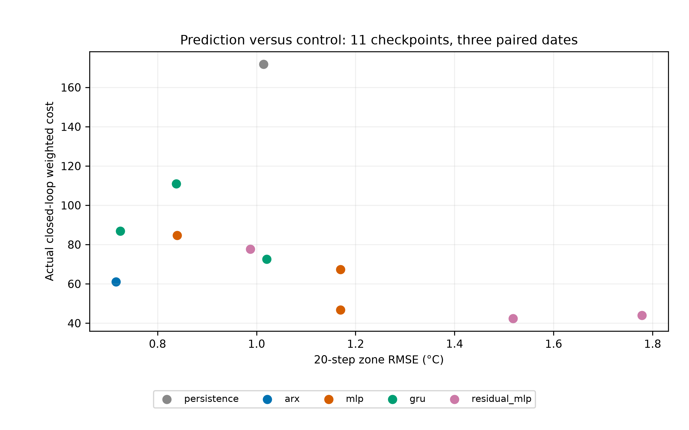

# Industrial World Model Evaluation

**一个面向楼宇控制的动作条件世界模型评测项目。** 项目以 [BOPTEST](https://github.com/ibpsa/project1-boptest) 楼宇与 HVAC 仿真为主要平台，比较模型的状态预测、长时序误差和模型预测控制（MPC）表现，并提供可追溯的评测流程。

核心问题是：**预测误差更低的模型，是否也能带来更好的控制效果？** 项目同时进行固定动作计划下的开环评测与真实模拟器中的闭环评测；控制器输出的动作由 BOPTEST 执行，指标由确定性代码计算。

> BOPTEST 是仿真平台。本仓库的结果用于研究与评测，不构成真实楼宇部署或工业安全保证。

## 功能概览

- **动作条件建模**：比较 Persistence、ARX、历史 MLP、残差 MLP 和 GRU，使用公开观测、动作、天气与日历特征预测下一步观测及区间能耗。
- **预测评测**：统一评估单步、teacher forcing 与自由递推，统计逐变量及不同预测时域的误差、有效比例和失败事件。
- **闭环控制**：将不同模型接入相同预算的随机 shooting MPC，记录温度跟踪、舒适度、能耗、成本、决策时间和后备动作。
- **鲁棒性**：在季节变化、目标变化、观测噪声和传感器缺失条件下评估；分别报告预测和控制结果。
- **可追溯运行**：通过统一配置和 Runner 保存版本、哈希、轨迹、指标、日志和失败上下文，支持容器执行及受限续跑。
- **Agent 编排**：将自然语言转换为受限实验配置；工具白名单、结果审核和人工审批由程序执行，指标不由大模型生成。

## 系统架构


模型预测只用于评价动作或生成规划；模拟环境的实际状态由 BOPTEST 推进。各层职责见[架构说明](docs/architecture.md)，实验配置和信息边界见[评测协议](docs/week6_protocol.md)。

## 代表性结果

下表来自 Week 6 的 BOPTEST 实验，展示三个主要参考日期的平均结果。温度 RMSE 是 **20 步（5 小时）末端预测误差**；闭环成本来自另一个滚动 MPC 实验，是舒适度、能耗和动作变化的加权评分，并非电费。

| 模型 | 温度 RMSE ↓ | 闭环成本 ↓ | 能耗 ↓ | 舒适偏差 ↓ |
| --- | ---: | ---: | ---: | ---: |
| ARX | 0.716 °C | 61.00 | 33.67 kWh | 18.03 °C·h |
| Persistence | 1.014 °C | 171.74 | 72.94 kWh | 34.65 °C·h |
| MLP，seed 43 | 1.170 °C | 46.79 | 28.33 kWh | 13.66 °C·h |
| 残差 MLP，seed 44 | 1.518 °C | 42.43 | 38.46 kWh | 3.84 °C·h |

这些数值展示预测排序和控制排序可能不同，不能仅凭跨日期均值推断原因。[完整实验表、条件和原始结果](reports/week6/week6.md#预测控制一致性)包括全部 11 个检查点及配对案例；[Week 8 报告](reports/week8/week8.md)汇总了 Week 5–7 的结果与来源。



## 快速开始

### 前置条件

- Linux 或 WSL 2、Python 3.11；容器方案需要 Docker 和 Docker Compose。
- 已运行 BOPTEST v0.9.0 的 `bestest_hydronic_heat_pump` 案例服务，默认地址为 `http://127.0.0.1`。
- 已准备并校验配置要求的 BOPTEST FMU、冻结数据和模型检查点；本地 Qwen Agent 还需单独下载模型权重。

从零下载 BOPTEST、准备资产、核对 SHA256 和处理已知构建问题，见[环境准备与复现指南](docs/setup_reproduction.md)。首次安装、镜像构建及资产下载可能耗时，**不计入**下方短评测时间。

### 运行短评测

在项目根目录，使用已安装依赖的 Python 3.11 环境：

```bash
# 确认 BOPTEST 服务可访问
curl --noproxy '*' -fsS http://127.0.0.1/testcases

# 校验配置和冻结资产；此步骤不推进仿真
python -c 'from pathlib import Path; import yaml; from benchmark.config import validate_config; c=yaml.safe_load(Path("configs/benchmark/boptest_smoke.yaml").read_text()); validate_config(c, Path.cwd()); print("配置和文件校验通过")'

# 运行 Persistence、ARX 和 embedded 基线的短评测
python run_benchmark.py --config configs/benchmark/boptest_smoke.yaml
```

每次运行的结果写入独立的 `reports/runs/<run-id>/`，包括 `config.yaml`、`versions.json`、`input_hashes.json`、`metrics.json`、`trajectories.csv`、日志及状态。异常时保留失败上下文。查看某次运行：

```bash
python scripts/check_week7.py --run reports/runs/<run-id>
```

将 `<run-id>` 替换为实际目录名；[统一配置与产物协议](docs/benchmark_protocol.md)说明完整字段、单位和失败策略。更多容器、续跑与追踪用法见 [Week 7 报告](reports/week7/week7.md)。

### 在 CPU 容器中复现

前提是冻结资产、`external/qwen-agent` 和 BOPTEST 服务均已准备，且 Docker Desktop 支持 host networking。以下命令从自然语言运行本地 Agent；项目目录会挂载到容器并保存结果。

```bash
docker compose -f deployment/benchmark/compose.yaml build
docker build -f deployment/agent/Dockerfile -t industrial-agent-week8:local .
docker run --rm --network host --user "$(id -u):$(id -g)" \
  -e OMP_NUM_THREADS=4 -e HF_HUB_OFFLINE=1 \
  -v "$PWD:/workspace" -w /workspace industrial-agent-week8:local \
  python scripts/run_local_agent.py --device cpu --model-dir external/qwen-agent \
  --revision 989aa7980e4cf806f80c7fef2b1adb7bc71aa306 \
  --expected-sha256 dd924a11b4c220f385b51ffa522daea7c9f3d850e31b162bb5661df483c6d3ee \
  --request '运行 BOPTEST，比较 persistence 和 arx'
```

已准备好资产后的单次 CPU 容器实测为 **92.96 秒**，不包括镜像构建和下载；不同设备及服务负载下时间会变化。会话与复核证据见[容器验收记录](reports/week8/container_timed_verification.json)。

## Agent 与安全边界

Agent 将请求转换为结构化意图和冻结模板配置，再调用 `validate_config`、`run_benchmark` 和 `summarize_results`；程序限制可用环境、模型与执行预算。LangGraph 对超过阈值的模型组合请求人工批准，并将批准绑定到配置摘要。失败、超时和审核不通过会记录在案，不视为成功。详见 [Agent 协议](docs/agent_protocol.md)。

在 20 条**参与开发的用例**上，规则流程和本地 LLM 配合固定编排各完成 6/6 条合法请求的真实仿真与审核；另一次自主选择首个工具的严格评分为 **7/20**。这不是独立泛化测试，不能据此认为 LLM 能可靠自主处理任意实验。[评测方法与逐条结果](reports/week8/agent_eval.md)。

## 测试

以下离线测试不要求运行 BOPTEST 服务：

```bash
python -m unittest tests.test_metrics tests.test_boptest_control \
  tests.test_week6_control tests.test_agent_errors tests.test_agent_eval \
  tests.test_agent_schemas tests.test_agent_react_guard
```

GitHub Actions 运行静态检查和短单元测试；真实服务集成测试需单独部署 BOPTEST 和冻结资产：

```bash
BOPTEST_INTEGRATION=1 python -m unittest tests.test_benchmark_integration
```

## 项目结构

```text
configs/       模型、环境、实验和 benchmark 配置
data/          轨迹采集、预处理、切分与数据
models/        预测基线及动作条件动力学模型
simulators/    热工、Industrial Benchmark 和 BOPTEST 适配器
controllers/   规则控制、LQR 与 MPC
evaluators/    预测、rollout、鲁棒性和闭环评测
metrics/       预测、控制与有效性指标
agents/        工具、配置生成、审核和状态机
benchmark/     配置校验、运行、产物及追踪
deployment/    BOPTEST 与评测容器配置
reports/       分周报告、图表及实验结果
tests/         单元、集成与回归测试
```

## 局限与资料

- Week 6 使用单个 BOPTEST 案例和有限日期；公开观测不涵盖全部建筑内部状态，季节测试也不等同于对所有外部分布的覆盖。
- 模型可能预测无效能耗或触发 fallback；软约束和释放控制只是实验机制，不能替代真实系统安全设计。
- 不同环境、信息集和成本定义下的结果不能直接比较；具体样本数和聚合方式见各实验报告。
- 项目自身尚未声明代码许可证；数据和第三方资产来源及许可线索见[第三方说明](docs/third_party.md)。实验文件取舍见[产物保存策略](docs/artifact_policy.md)。

更多资料：[Week 5 预测评测](reports/week5/week5.md) · [Week 6 BOPTEST 实验](reports/week6/week6.md) · [Week 7 评测流水线](reports/week7/week7.md) · [Week 8 Agent](reports/week8/week8.md) · [面试材料](docs/interview/)。
