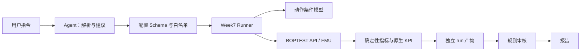

# 系统架构

Week 6 的 BOPTEST 模型以 16 步观测、动作和天气/日历历史预测下一公开观测及本步能耗。MPC 在 BOPTEST 模拟器中执行动作。本地 Qwen 已完成真实 BOPTEST 演示；20 条开发指令中，6 条合法请求各自完成规则与 LLM 流程的真实运行，其余 14 条不启动仿真。CPU 容器复现与人工审批恢复均已通过审核。自主选择首个工具的严格匹配仅为 7/20，且用例参与过开发，不能视为独立泛化结果。详情见 [Week 8 报告](../reports/week8/week8.md) 和 [Agent 对照](../reports/week8/agent_eval.md)。

## 各层职责

| 层 | 代码入口 | 主要职责 |
| --- | --- | --- |
| Agent | `agents/` | 理解请求、生成候选配置与提出工具调用；需通过白名单 |
| 统一运行器 | `run_benchmark.py`、`benchmark/` | 校验配置、加载模型与环境、管理运行和记录 |
| 模型和控制器 | `models/`、`controllers/` | 预测动作后果，MPC 选择控制动作 |
| 环境与评测 | `simulators/`、`evaluators/`、`metrics/` | 与 BOPTEST 交互，确定性计算预测与控制指标 |
| 结果和审核 | `reports/runs/`、`agents/result_auditor.py` | 保存轨迹与配置并复核结果完整性、哈希和单位 |

仿真服务独立于 Agent 容器运行，真实状态由 BOPTEST 推进；Agent 不替代物理仿真，也不负责编造或修改指标。
