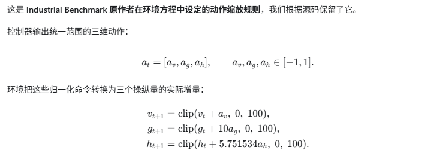

# 模拟器字段映射与日志规范

本规范适用于 Siemens Industrial Benchmark Python 2.0，源码固定为 afeed6933ed1aff760a350f6300ae963bfc7bc04。适配器为 simulators/industrial_benchmark.py。数值均采用上游基准尺度，时间单位为 step。

## 公开观测与控制量

观测数组形状为 (6,)，类型为 float32，顺序如下。可观测表示可供策略使用，可控表示能否直接通过动作改变。

| 索引 | 英文名 | IDS 字段 | 单位 | 范围 | 可观测性 | 可控性 |
|---|---|---|---|---|---|---|
| 0 | setpoint（含义：在给定工况下，调节 velocity、gain、shift，使成本较低） | p | 基准尺度 | [0,100] | 公开 | reset 配置；回合内固定 |
| 1 | velocity | v | 基准尺度 | [0,100]，更新后截断 | 公开 | 增量动作直接控制 |
| 2 | gain | g | 基准尺度 | [0,100]，更新后截断 | 公开 | 增量动作直接控制 |
| 3 | shift | h | 基准尺度 | [0,100]，更新后截断 | 公开 | 增量动作直接控制 |
| 4 | fatigue | f | 基准指标 | wrapper 声明 [0,1000] | 公开 | 经动力学间接影响 |
| 5 | consumption | c | 基准指标 | wrapper 声明 [0,1000] | 公开 | 经动力学间接影响 |

fatigue、consumption 的空间边界是上游 wrapper 的声明。consumption 包含高斯随机项，因此该声明应与实际观测范围分别核查，日志保留实际原值。

## 动作与时间尺度

动作数组形状为 (3,)，每项均为有限数值且属于 [-1,1]。适配器在执行前拒绝非法动作。

| 索引 | 动作英文名 | 单位 | 对操纵量的一步更新 | 可观测性 | 可控性 |
|---|---|---|---|---|---|
| 0 | delta_velocity | 归一化命令 | v 加上 action[0] | 策略输出，日志可见 | 是 |
| 1 | delta_gain | 归一化命令 | g 加上 10 × action[1] | 策略输出，日志可见 | 是 |
| 2 | delta_shift | 归一化命令 | h 加上约 5.751534 × action[2] | 策略输出，日志可见 | 是 |

shift 系数的精确定义为 sin(15°) / 0.9 × 100 / 5。三项更新后均截断至 [0,100]。

每次 step 执行一次增量并推进一个仿真步，action_repeat=1。新的操纵量保留到后续动作继续更新。连续多步输入相同非零动作会重复累加；零动作保持操纵量，内部动态仍继续演化。上游没有定义秒数，因此 physical_step_seconds=null，timestamp=null，step 作为时间坐标。默认回合上限为 1000 步。

## 成本、奖励与扰动

上游原生成本和 classic 奖励为

$$
\mathrm{cost}_{t+1}=3\,\mathrm{fatigue}_{t+1}+\mathrm{consumption}_{t+1},
\qquad r_t=-\mathrm{cost}_{t+1}.
$$

这里的成本采用基准尺度。回合累计成本是所有动作后 cost 的和，平均成本再除以执行步数，初始 reset 记录不参与累计。

本配置工况固定为 setpoint=50，记录在 disturbance.setpoint。内部随机冲击由上游生成，当前接口没有逐项公开其实际样本，disturbance.noise=null。日志中可以记录随机种子以重建随机过程。

## 诊断内部状态

以下字段位于 info.upstream_info。它们可用于评测和诊断，控制器入口使用公开 observation。

| 英文名 | 原始字段 | 含义 | 单位及范围 | 可观测性 | 可控性 |
|---|---|---|---|---|---|
| setpoint 至 consumption | p,v,g,h,f,c | 六项公开量的诊断副本 | 同观测表 | 公开 | 同观测表 |
| op_cost_t0 至 op_cost_t9 | o[0] 至 o[9] | 运行成本缓冲区的十个槽位 | 基准成本尺度；接口未声明边界 | 诊断可见 | 间接影响 |
| ml1 | gs_domain | Goldstone 内部域枚举 | 上游枚举值 | 隐藏，诊断可见 | 无直接动作 |
| ml2 | gs_sys_response | 内部响应模式枚举 | 上游枚举值 | 隐藏，诊断可见 | 无直接动作 |
| ml3 | gs_phi_idx | 内部方向索引 | 上游索引值 | 隐藏，诊断可见 | 无直接动作 |
| hv | hv | 隐藏速度记忆 | 基准尺度；wrapper 未声明边界 | 隐藏，诊断可见 | 间接影响 |
| hg | hg | 隐藏增益记忆 | 基准尺度；wrapper 未声明边界 | 隐藏，诊断可见 | 间接影响 |

upstream_info 是上游 wrapper 选择导出的诊断集合。IDS 还维护其他内部字段，因此记录该字典时应保留其原始键名。

适配器另提供 info.step、info.time_unit、info.cost，时间上限时提供 info.end_reason='time_limit'。

## reset、终止与失败

reset(seed, options) 返回 (observation, info)。允许 options.setpoint 覆盖当前回合工况，其他键报 ValueError。相同种子与动作序列产生相同轨迹。动作采样器需单独调用 action_space.seed(seed) 才能复现随机策略。

step(action) 返回 (observation, reward, terminated, truncated, info)。

| 情况 | terminated | truncated | 处理 |
|---|---|---|---|
| 正常推进 | false | false | 继续回合 |
| 达到步数上限 | false | true | end_reason=time_limit，结束后需 reset |
| 未 reset 或回合结束后继续 step | 无返回 | 无返回 | 抛 RuntimeError |
| 非法动作 | 无返回 | 无返回 | 抛 ValueError，步数不增加 |
| 上游执行异常 | 无返回 | 无返回 | 异常向上传递，适配器要求 reset |

当前上游以时间上限设置 done，适配器将其映射为 truncated；当前没有自然任务终止条件。采集器遇到异常应写独立失败事件，保存异常类型、消息和最后成功步数，将 episode_status 设为 failed。失败事件不计入完整回合数。

## 统一日志格式

后续标准采集器采用 JSONL，每行一个对象。下表定义输出契约，第 2 步已有 episode.jsonl 仍保留当时的上游原始格式。

| 字段 | 类型/单位 | 定义及可用范围 |
|---|---|---|
| schema_version | string | 当前规范版本 1.0 |
| episode_id | string | 回合唯一标识 |
| seed | integer | reset 的用户种子 |
| step | integer，step | 初始记录为 0，动作后从 1 递增 |
| timestamp | null | 没有物理时间映射 |
| time_unit | string | step |
| state | object | 六个具名公开观测，对应本行 observation |
| observation | array[6] | 控制器可见观测 |
| action | array[3] 或 null | 导致本行状态的增量动作；reset 行为 null |
| disturbance | object | setpoint 为当前工况；noise 为 null |
| cost | number 或 null | 本次转移后的原生成本；reset 行为 null |
| reward | number 或 null | 本次转移奖励；reset 行为 null |
| constraints | object | action_valid、observation_in_declared_space；reset 的 action_valid 为 null |
| terminated | boolean | 当前始终 false |
| truncated | boolean | 时间上限时为 true |
| done | boolean | terminated 或 truncated |
| end_reason | string 或 null | 正常中间步为 null，时间上限为 time_limit |
| upstream_info | object | 深拷贝诊断字段，控制器不得通过日志反向读取 |

constraints 记录接口边界检查结果。观测超出声明空间时保留原值并标记 false。IB 当前实验未定义独立物理安全阈值。

行 step=k 对应使用 observation[k-1] 选择 action[k-1] 后得到的 observation[k]，该行成本和奖励也属于这次转移。拼接训练样本时按此关系构造，避免把动作后的观测当作动作前输入。

## 源码依据

变量与动作公式见固定提交的 [IDS.py](https://github.com/siemens/industrialbenchmark/blob/afeed6933ed1aff760a350f6300ae963bfc7bc04/industrial_benchmark_python/IDS.py)，观测空间、诊断映射和 done 条件见 [IBGym.py](https://github.com/siemens/industrialbenchmark/blob/afeed6933ed1aff760a350f6300ae963bfc7bc04/industrial_benchmark_python/IBGym.py)。
