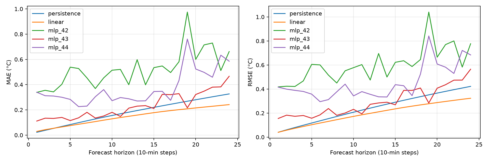
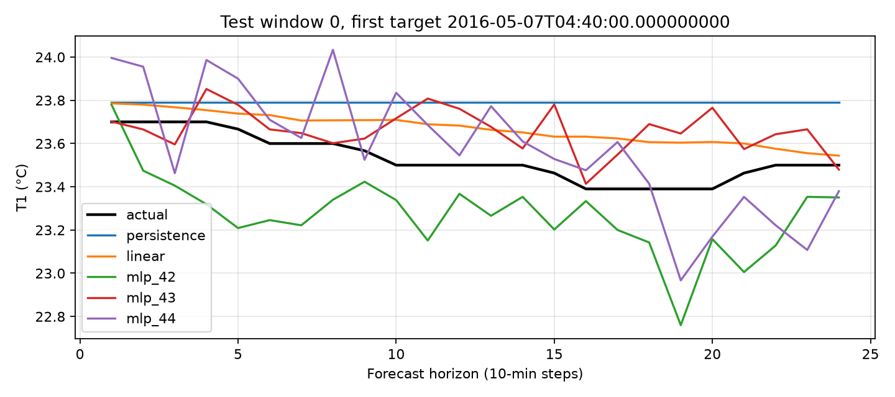

# Week 1：楼宇时序预测实验报告

## 数据与任务

数据：[UCI Appliances Energy Prediction](https://archive.ics.uci.edu/dataset/374/appliances+energy+prediction)，真实住宅数据，19,735 行，10 分钟间隔。原始 CSV SHA-256：`2820bf712ad0275cb18b85a05250926100d8e65ebb9f4d2d016ca91ea152a25d`。

输入为过去 144 步（24 小时）的厨房温度 $T_1$、客厅温度 $T_2$、洗衣房温度 $T_3$、厨房相对湿度 $RH_1$、气象站室外温度 $T_{\mathrm{out}}$；目标为未来 24 步（4 小时）的 $T_1$。所有模型一次直接输出 24 步，使用同一批测试窗口。

## 切分与防泄漏

| 集合 | 起始时间 | 结束时间 | 行数 | 窗口数 |
|---|---|---|---:|---:|
| train | 2016-01-11T17:00:00 | 2016-04-16T15:10:00 | 13814 | 13647 |
| val | 2016-04-16T15:20:00 | 2016-05-07T04:30:00 | 2960 | 2937 |
| test | 2016-05-07T04:40:00 | 2016-05-27T18:00:00 | 2961 | 2938 |

按时间排序后 70%/15%/15% 切分。预测目标完整位于所属区间；验证和测试允许使用起点前已观测历史。训练集拟合 Z-score 均值与总体标准差，其他集合复用；结果还原为 °C。时间网格和所选特征未发现缺失；若出现缺失，保留标记，输入最多向前填充 6 步，真实目标缺失的窗口丢弃。未提供未来真实目标或未来天气。

## 模型与选择

- Persistence：用输入窗口最后一个 T1 预测所有未来步。
- 线性 Ridge：展平历史输入，候选 alpha 为 0.1、1、10、100；验证集 MSE 选出 1.0。该模型不包含动作。
- MLP：两层 64 单元 ReLU，Adam 学习率 0.001，batch 128，最多 40 epoch，验证集 MSE 早停耐心值 5；种子 42、43、44，分别使用各自验证集最优权重。

## 测试集总体指标

下表对所有测试窗口及全部 24 个步长汇总；单位 °C。

| 模型 | MAE | RMSE |
|---|---:|---:|
| persistence | 0.1832 | 0.2688 |
| linear | 0.1472 | 0.2143 |
| mlp_42 | 0.5235 | 0.6178 |
| mlp_43 | 0.2309 | 0.3152 |
| mlp_44 | 0.3719 | 0.4716 |
| MLP 三种子均值 ± 样本标准差 | 0.3754 ± 0.1464 | 0.4682 ± 0.1513 |

## 重点步长指标

| 模型 | 步长 | 时间（分钟） | MAE (°C) | RMSE (°C) |
|---|---:|---:|---:|---:|
| persistence | 1 | 10 | 0.0223 | 0.0404 |
| persistence | 6 | 60 | 0.0988 | 0.1355 |
| persistence | 12 | 120 | 0.1818 | 0.2413 |
| persistence | 24 | 240 | 0.3264 | 0.4221 |
| linear | 1 | 10 | 0.0293 | 0.0401 |
| linear | 6 | 60 | 0.0860 | 0.1171 |
| linear | 12 | 120 | 0.1490 | 0.1979 |
| linear | 24 | 240 | 0.2417 | 0.3231 |
| mlp_42 | 1 | 10 | 0.3387 | 0.4178 |
| mlp_42 | 6 | 60 | 0.5277 | 0.6006 |
| mlp_42 | 12 | 120 | 0.3995 | 0.4751 |
| mlp_42 | 24 | 240 | 0.6620 | 0.7768 |
| mlp_43 | 1 | 10 | 0.1114 | 0.1550 |
| mlp_43 | 6 | 60 | 0.1369 | 0.1850 |
| mlp_43 | 12 | 120 | 0.2140 | 0.2729 |
| mlp_43 | 24 | 240 | 0.4662 | 0.5647 |
| mlp_44 | 1 | 10 | 0.3399 | 0.4160 |
| mlp_44 | 6 | 60 | 0.2258 | 0.2949 |
| mlp_44 | 12 | 120 | 0.2878 | 0.3560 |
| mlp_44 | 24 | 240 | 0.5856 | 0.6837 |





完整结果：[逐步长指标](week1_evaluation/metrics_by_horizon.csv)、[总体指标](week1_evaluation/metrics_overall.csv)、[逐窗口预测及真实值](week1_evaluation/predictions.csv.gz)、[实验配置](week1_baselines/config.json)。

## 结果与局限

在线性模型与 Persistence 的比较中，Persistence 的一步 MAE 更低；线性模型在 6、12、24 步的 MAE 更低。三个 MLP 运行的总体误差均高于线性模型且种子差异较大；这仅说明当前模型和训练配置的表现，不能推断所有 MLP 都较差。轨迹图仅展示一个窗口。

数据来自单栋住宅而非工业设备，时间跨度有限；相邻窗口重叠，指标并非独立样本估计。该数据没有明确 HVAC 控制指令，本实验不是动作条件动力学或闭环控制评测。天气站小时数据经过插值，其在线实时可用性需进一步核实。直接多步预测不等于自由递推 rollout。

## 复现

环境：WSL2，Python 3.11，PyTorch 2.8.0+cu128，NumPy 2.4.6，pandas 3.1.1，scikit-learn 1.9.1，matplotlib 3.11.2；本次 MLP 使用 CUDA。先从 UCI 下载 CSV 至 `data/raw/energydata_complete.csv`。在项目根目录运行：

```bash
conda activate mvp
python data/preprocess.py
python -m unittest discover -s tests
python run_week1_baselines.py
python -m evaluators.prediction
```

本机连续两次运行的 `metrics_overall.csv` SHA-256 均为 `24e7387c69f1600e78d112d992372bb717581f02aece083d11ff15b13519e7d0`，10 项测试通过。跨硬件、库版本或 GPU 内核不保证逐位一致；需比较合理数值容差。

本次基准 Git HEAD 为 `2006037ea9f92b6e5b1fc8af55a4073627614001`，但实验代码当时尚未提交，不能用该 commit 单独复现。确切源码 SHA-256 见 [week1_code_hashes.json](week1_code_hashes.json)；提交当前代码后应记录新的 commit。

**P0 状态**：真实数据预测、切分检查、指标和报告已完成；原 Week 1 P0 对明确动作输入的 ARX/动力学要求仍待模拟器数据补齐。
