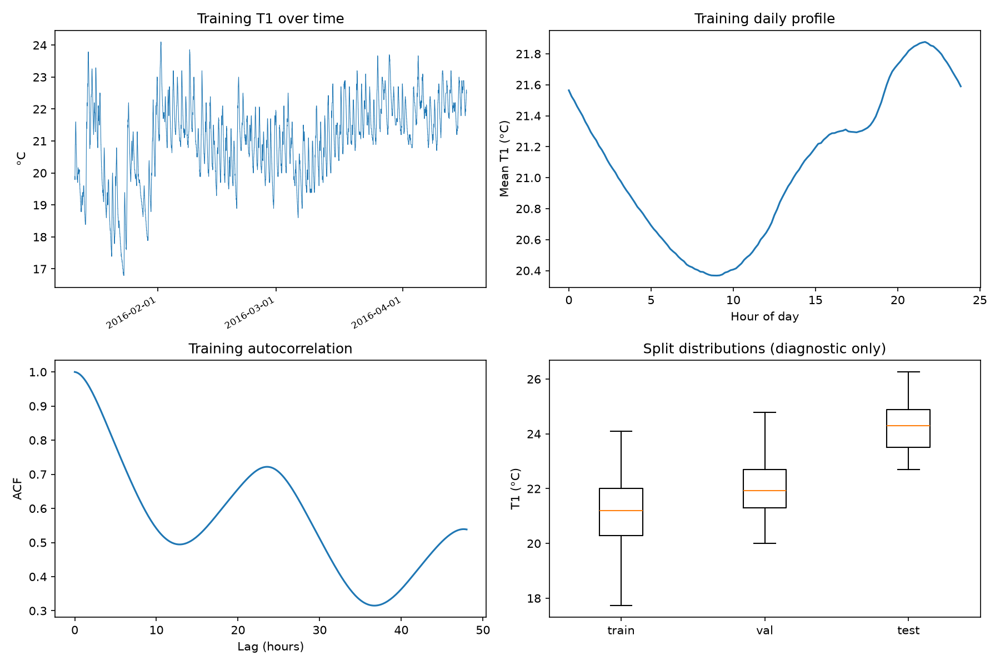
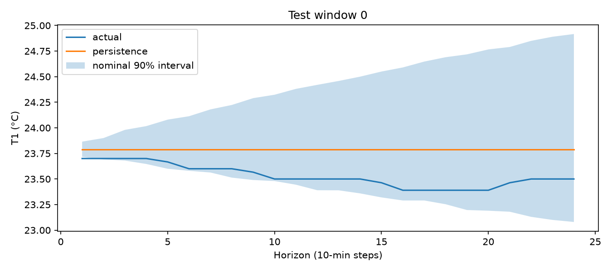
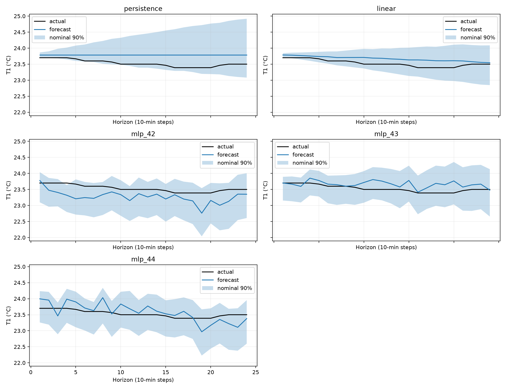
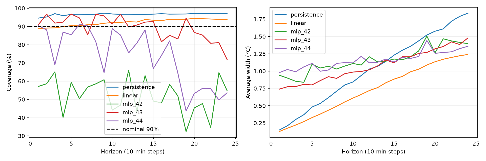
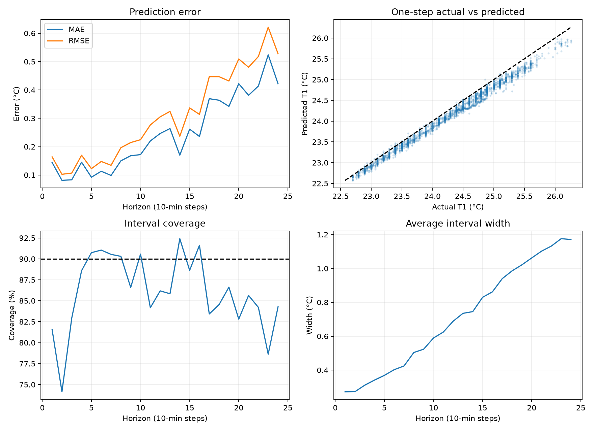
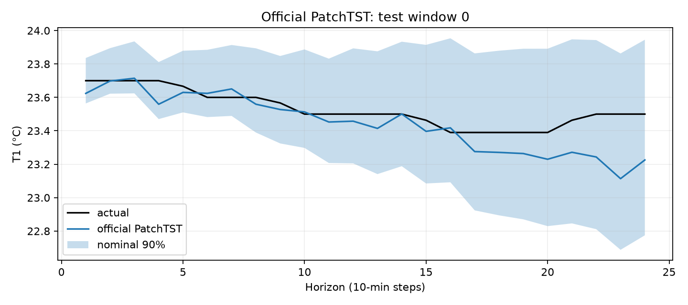

# Week 1 P1 实验报告

## 时序诊断

数据为 UCI Appliances Energy Prediction，沿用 Week 1 的时间切分。全部 19,734 个相邻时间间隔均为 10 分钟。T1 训练集平均 21.07 °C，验证集 22.01 °C，测试集 24.24 °C，显示明显的时间分布差异；这只是描述性诊断，并不证明漂移的原因。训练集一阶自相关约 0.999，24 小时滞后自相关约 0.721；日内均值曲线见下图。高自相关也可能受趋势影响，不能单独证明周期性。

基于训练集的 1.5 IQR 阈值为 17.725–24.565 °C，训练/验证/测试分别有 169/39/1182 个点超出该阈值；这些是统计标记，不代表传感器故障，也没有删除。测试集统计只用于事后描述，不用于模型选择。



## 预测区间

以固定的 Persistence 为点预测，逐步长使用验证集残差的 5% 和 95% 分位数形成名义 90% 预测区间，然后冻结并在测试集评估。该区间是经验方法，不对时间相关或分布漂移提供 90% 覆盖保证。区间宽度以 °C 计：

| 步长 | 时间 | 覆盖率 | 平均宽度 (°C) |
|---:|---:|---:|---:|
| 1 | 10 分钟 | 94.6% | 0.148 |
| 6 | 1 小时 | 96.7% | 0.533 |
| 12 | 2 小时 | 96.7% | 1.030 |
| 24 | 4 小时 | 97.1% | 1.837 |

步长越远区间越宽。这里覆盖率按测试窗口统计，窗口互相重叠，不能当作独立样本；覆盖率高本身也不能证明区间质量好，应同时看宽度。



[各步区间指标](week1_p1/interval_metrics.csv)；`week1_p1/interval_predictions.npz` 保留各窗口真实值、预测、上下界和目标起始时间。

## PatchTST 小规模实验

采用单变量、受 PatchTST 启发的小模型：T1 历史长度 144、patch 长度 16、stride 8、两层 Transformer、4 个注意力头、隐藏维度 32；直接预测未来 24 步。固定种子 42，验证集早停。它是单变量简化实现，不是完整官方实现或预训练模型。为了输入公平，对照线性模型和 Persistence 都只使用同样的 T1 历史；测试窗口和时间切分与 P0 一致。

| 模型 | 所有步 MAE (°C) | 所有步 RMSE (°C) | 24 步 MAE (°C) |
|---|---:|---:|---:|
| Persistence | 0.1832 | 0.2688 | 0.3264 |
| 线性（仅 T1） | 0.1530 | 0.2264 | 0.2820 |
| PatchTST 简化版 | 0.7254 | 0.8659 | 0.9412 |

当前设置下简化 PatchTST 明显落后，不能推断 PatchTST 架构普遍较差；这里只做了一次种子运行、简单超参数设置，且测试分布与训练期存在差异。完整结果与配置见 [指标](week1_p1/patchtst_metrics.csv) 和 [配置](week1_p1/patchtst_config.json)，预测和检查点保存在同一目录。

## 复现

在项目根目录，激活已有 mvp 环境，且先完成 Week 1 预处理：

```bash
conda activate mvp
python data/preprocess.py
python run_week1_diagnostics.py
python -m unittest discover -s tests -p test_patchtst.py
python run_week1_patchtst.py
```

代码尚未提交 Git；跨设备和软件版本可能产生数值差异。输出均在 `reports/week1_p1/`，再次执行会覆盖相应文件。

## 各模型预测区间补充

对 Persistence、线性模型和三个 MLP 种子，分别使用各模型验证集残差的 5%/95% 分位数，再应用于同一测试集。每个模型单独校准，不共享残差。线性模型按保存的 alpha 在训练集重新拟合，MLP 使用已保存权重；均检查了重建的测试预测与原实验一致。

| 模型 | 1 步覆盖率 | 6 步覆盖率 | 12 步覆盖率 | 24 步覆盖率 | 24 步平均宽度（°C） |
|---|---:|---:|---:|---:|---:|
| Persistence | 94.6% | 96.7% | 96.7% | 97.1% | 1.837 |
| 线性 | 88.7% | 90.4% | 92.6% | 93.9% | 1.240 |
| MLP seed 42 | 57.1% | 50.4% | 65.9% | 54.8% | 1.397 |
| MLP seed 43 | 91.0% | 94.7% | 89.7% | 71.9% | 1.478 |
| MLP seed 44 | 90.4% | 91.2% | 75.5% | 53.6% | 1.358 |

MLP 的覆盖率随种子和步长变化明显，部分情况下低于名义 90%。验证集同时用于模型选择/早停和区间校准，因此校准可能偏乐观；未来可使用独立校准集。时间相关、重叠窗口和分布变化也使名义覆盖率没有保证。





完整结果见 [逐步长区间指标](week1_p1/model_intervals/metrics_by_horizon.csv)，逐窗口预测和上下界保存在 `week1_p1/model_intervals/predictions.npz`。复现：`python run_week1_intervals.py`。

## PatchTST 预测区间补充

基于保存的单变量 PatchTST 检查点，在验证集分别计算各步 5%/95% 残差分位数，并在同一测试窗口上评估。恢复权重所得测试预测与原实验结果核对一致。

| 步长 | 测试覆盖率 | 平均宽度（°C） |
|---:|---:|---:|
| 1 | 18.9% | 0.277 |
| 6 | 35.4% | 0.486 |
| 12 | 39.7% | 0.790 |
| 24 | 42.2% | 1.369 |

本次覆盖率远低于名义 90%；验证期与测试期分布差异、模型误差变化及验证集同时用于早停和校准均值得进一步检查，但这里无法确定具体原因。当前结果只有一个随机种子，不能代表所有 PatchTST 配置。


逐步指标和预测上下界保存在 `week1_p1/patchtst_interval/`；复现命令为 `python run_patchtst_intervals.py`。

## 官方 PatchTST：诊断与区间

本节使用官方模型组件及五通道非重叠掩码预训练后的 checkpoint；与上面单变量简化模型是不同实验。验证集按步长计算 5%/95% 残差分位数，再固定用于测试集。验证集同时用于早停和区间校准，且窗口重叠，因此不提供覆盖率保证。

| 步长 | 覆盖率 | 平均宽度（°C） |
|---:|---:|---:|
| 1 | 81.6% | 0.272 |
| 6 | 91.0% | 0.403 |
| 12 | 86.2% | 0.688 |
| 24 | 84.3% | 1.171 |





逐步指标和逐窗口上下界见 `week1_p1/official_patchtst/interval_metrics.csv`、`interval_predictions.npz`。执行 `python plot_official_patchtst.py` 可重新生成，数据本身的日周期等诊断仍见原 `diagnostics.png`。
