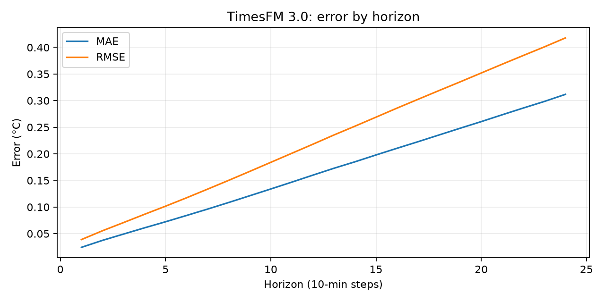
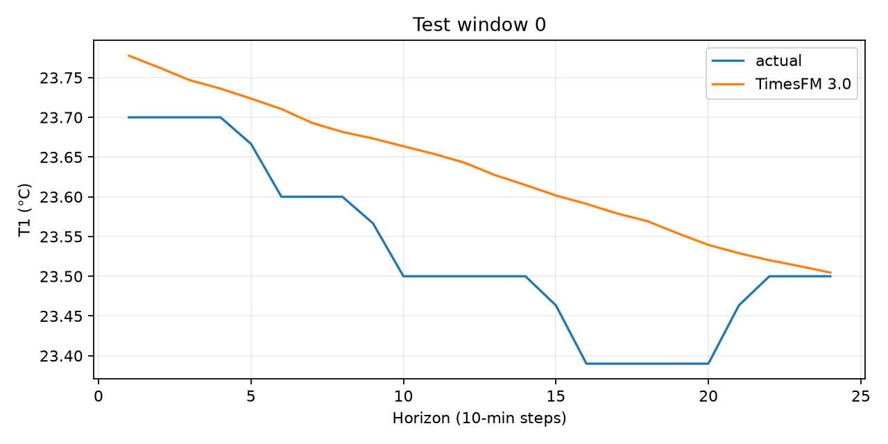

# Week 1 P2：TimesFM 零样本预测

## 任务与设置

使用已有 UCI 测试集 2,938 个相同窗口，输入过去 144 步 T1（摄氏度），直接预测未来 24 步；不提供其他变量、动作或未来协变量。使用缓存的 google/timesfm-3.0-pytorch 和 timesfm 3.0.2，不在本地数据上微调。预训练数据是否包含本数据集未知，因此零样本不等同于可证明的预训练数据隔离。

模型缓存 revision：`43046b85ec22d584a13f8098c2ed39c889e129c2`；设备 cuda，batch 32，加载 4.50 秒；全部窗口推理 53.57 秒（含首次调用预热及输出转换，CUDA 同步；不含模型加载）。

## 总体结果

| 模型 | 输入信息 | MAE °C | RMSE °C |
|---|---|---:|---:|
| timesfm3_t1 | T1 history only | 0.1666 | 0.2544 |
| persistence | T1 history only | 0.1832 | 0.2688 |
| linear | five historical features | 0.1472 | 0.2143 |
| mlp_42 | five historical features | 0.5235 | 0.6178 |
| mlp_43 | five historical features | 0.2309 | 0.3152 |
| mlp_44 | five historical features | 0.3719 | 0.4716 |
| linear_t1 | T1 history only | 0.1530 | 0.2264 |
| patchtst_t1 | T1 history only; simplified old model | 0.7254 | 0.8659 |
| official_patchtst_t1 | five-channel shared pretraining; T1 independent inference | 0.2452 | 0.3428 |

测试窗口的时间和真实值在合并前已逐项核对。相同 T1 历史的信息组可直接比较输入；五特征线性/MLP 获得额外历史观测。官方 PatchTST 在五通道上共享预训练，但预测 T1 时通道独立，因此不直接读取其他通道当前数值；历史信息一致也不意味着预训练和计算预算一致。

| 步长 | 时间 | TimesFM MAE °C | TimesFM RMSE °C |
|---:|---:|---:|---:|
| 1 | 10 分钟 | 0.0243 | 0.0389 |
| 6 | 60 分钟 | 0.0842 | 0.1174 |
| 12 | 120 分钟 | 0.1600 | 0.2181 |
| 24 | 240 分钟 | 0.3118 | 0.4179 |





同信息组中，TimesFM 的总体误差低于 Persistence、高于仅 T1 的线性模型；这只反映本数据和固定设置。测试窗口彼此重叠，不能当作独立观测；实际部署或控制有效性尚未验证。

## 复现与产物

```bash
conda activate mvp
python data/preprocess.py
python run_week1_timesfm.py
python plot_week1_timesfm.py
```

需要 timesfm 3.0.2、PyTorch 和已缓存的指定模型；首次获取模型需网络。运行会覆盖当前产物。完整设置与耗时见 [config.json](timesfm/config.json)，比较表见 [model_comparison.csv](timesfm/model_comparison.csv)，逐步指标见 [metrics_by_horizon.csv](timesfm/metrics_by_horizon.csv)，逐窗口预测见 `timesfm/predictions.npz`。

不同硬件/库版本可能有数值差异。源码尚未提交，实验前应提交并记录 commit。模型选型见 [model_selection.md](model_selection.md)。
