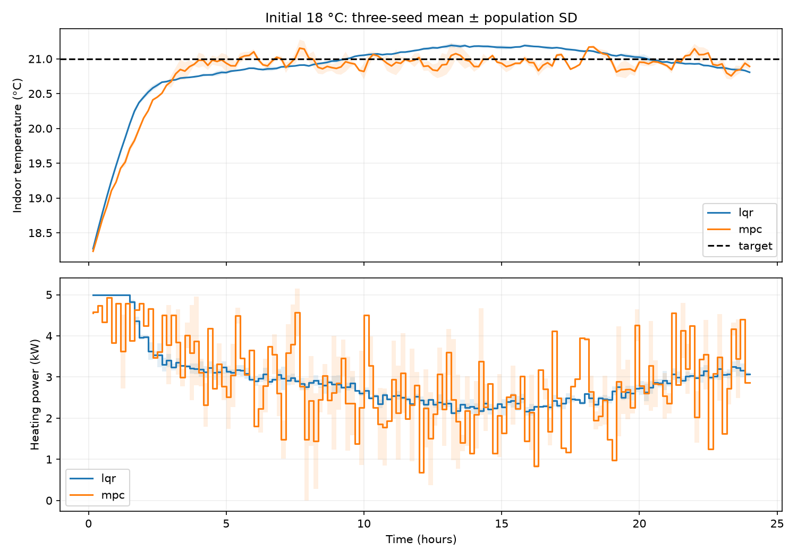
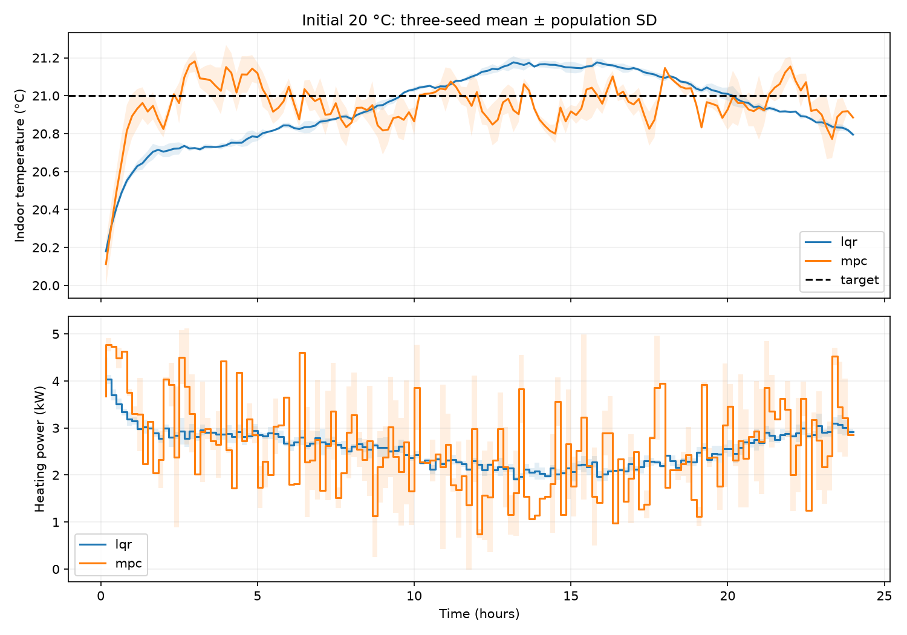
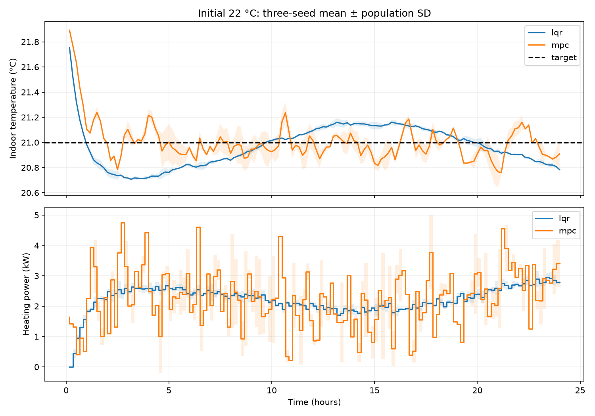

# Week 2：LQR 与模拟安全后备

## 工作点与离散 LQR

固定室外温度 6 °C，室温目标 21 °C，计算墙温稳态 17.25 °C、稳态加热功率 3.075 kW；功率位于 0～5 kW 范围。模型为线性仿射方程，围绕该点写成偏差系统。

$$
Q=\begin{bmatrix}1&0\\0&0.1\end{bmatrix},\qquad R=0.1,\qquad K=\begin{bmatrix}2.39897&0.36802\end{bmatrix}.
$$

使用离散代数 Riccati 方程得到反馈增益，原始动作按 0～5 kW 限幅。限幅后的反馈不再是严格无约束 LQR 最优解；只用带噪状态观测，固定工作点天气，没有未来天气前馈。完整矩阵 A、B、Q、R、K 见配置文件。

## 配对闭环：三个种子

每个初始温度对应三个固定环境种子 42、43、44；同一种子下控制器的天气和噪声相同。表中是三次回合的均值 ± 总体标准差；成本为相同的环境示例评分，不是电费。

| 初始温度 | 控制器 | 累计评分 | 跟踪 MAE °C | 能耗 kWh | 舒适违规率 |
|---|---|---:|---:|---:|---:|
| 18 °C | lqr | 106.658 ± 0.334 | 0.250 ± 0.004 | 70.275 ± 0.056 | 5.556 ± 0.000% |
| 18 °C | mpc | 113.629 ± 0.621 | 0.252 ± 0.004 | 69.803 ± 0.191 | 7.407 ± 0.327% |
| 20 °C | lqr | 67.718 ± 0.329 | 0.158 ± 0.005 | 61.997 ± 0.053 | 0.000 ± 0.000% |
| 20 °C | mpc | 65.984 ± 0.836 | 0.111 ± 0.011 | 62.226 ± 0.118 | 0.231 ± 0.327% |
| 22 °C | lqr | 57.546 ± 0.284 | 0.140 ± 0.005 | 53.337 ± 0.054 | 0.000 ± 0.000% |
| 22 °C | mpc | 57.924 ± 0.245 | 0.118 ± 0.005 | 53.810 ± 0.219 | 0.000 ± 0.000% |

LQR 九个回合共出现 32 次原始动作限幅；单步原始和实际动作保存在每个轨迹 CSV。所有正常回合均完成 144 步，故障注入与正常回合分开。

## 安全与故障注入

舒适区 20～23 °C 与教学安全边界 12～30 °C 分开。控制前依据带噪观测：低于安全下限请求 5 kW、高于上限请求 0 kW；非法观测或动作请求 0 kW；有限越界动作限幅。环境推进后若真实室温越界，包装层标记自然终止并记录事件。初始越界在第一步检查，不能保证避免单步跨越或真实安全。环境本体仍对非法动作报错。

故障注入日志记录了高温、低温、非法动作、限幅、无有效候选、超时和模型异常。MPC 时间预算仅在预测步之间检查；异常记录类型和消息，并返回规则后备。安全边界是演示参数，不可用于真实设备。

见 [实验配置](results/lqr_safety/config.json)、[故障注入](results/lqr_safety/failure_injection.json)、[逐回合指标](results/lqr_safety/episode_metrics.csv) 与同目录原始轨迹。

## 复现

在项目目录执行：

    conda activate mvp
    python run_week2_lqr_safety.py
    python plot_week2_lqr_safety.py
    python -m unittest discover -s tests
