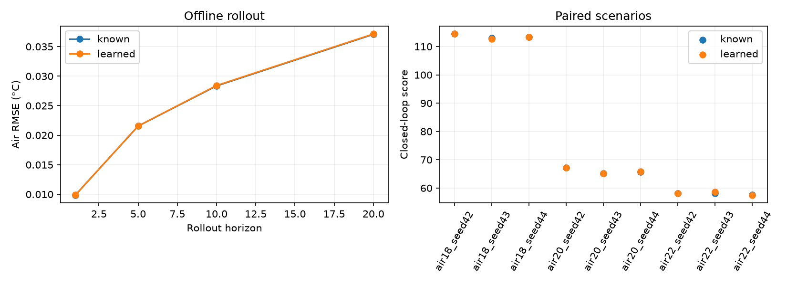

# Week 2：系统辨识与动力学模型闭环比较

## 实验协议

采集 45 个完整模拟回合，交替使用随机分段动作与规则控制；按 episode 划分训练 30、验证 6、测试 9。验证集保留但本次未用于选择模型。线性模型仅在训练回合拟合真实状态、实际动作、真实当前天气到下一真实状态。内部热负荷为常数，无法与截距单独辨识，合并在截距中。真实状态是模拟器特权标签，现实中未必可得。

离线预测从测试回合真实状态初始化，使用记录的未来动作和真实天气；每步将模型预测状态递推，不读取未来状态。此评测使用理想化未来天气，不是闭环控制时可获得的信息。为了各步长使用同一批起点，仅统计存在完整 20 步的起点，窗口互相重叠。

闭环实验在独立种子 42、43、44 和三组固定初始状态下比较已知无噪声方程与学习模型；控制器只收到带噪观测，天气预测保持当前观测值。两种 MPC 参数和候选随机种子相同，逐步检查天气及噪声相同。

## 离线预测结果

| 模型 | 预测步长 | 室温 MAE (°C) | 室温 RMSE (°C) | 墙温 RMSE (°C) |
|---|---:|---:|---:|---:|
| 已知方程 | 1 | 0.007884 | 0.009880 | 0.009978 |
| 学习模型 | 1 | 0.007899 | 0.009884 | 0.010012 |
| 已知方程 | 5 | 0.017224 | 0.021545 | 0.021642 |
| 学习模型 | 5 | 0.017264 | 0.021570 | 0.022068 |
| 已知方程 | 10 | 0.022449 | 0.028345 | 0.029642 |
| 学习模型 | 10 | 0.022553 | 0.028418 | 0.030734 |
| 已知方程 | 20 | 0.030009 | 0.037074 | 0.042833 |
| 学习模型 | 20 | 0.030163 | 0.037148 | 0.045263 |

## 配对闭环结果

九个配对回合平均累计评分：已知方程 79.179，学习模型 79.231；平均跟踪 MAE 分别为 0.160、0.161 °C。分场景和每个种子的原始结果见 [closed_loop_metrics.csv](results/system_identification/closed_loop_metrics.csv)。累计评分是跟踪误差平方和能耗数值之和，不是电费。

已知方程测试预测误差略低，闭环平均评分也略低；个别配对回合可能反转。模型都建立在相同的近线性仿真上，此结果不能证明预测误差和控制收益在一般情况下有固定关系。过程噪声使已知无噪声模型也无法完美预测。

参数见 [parameters.json](results/system_identification/parameters.json)，逐回合轨迹、配置和预测指标均保存在同一结果目录。重新运行：在项目根目录执行 python run_week2_identification.py。
