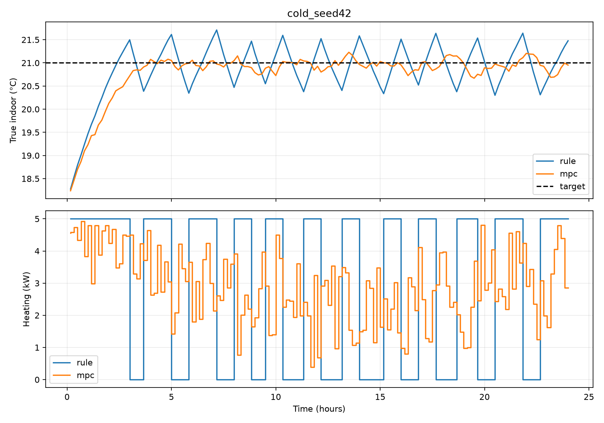

# Week 2：规则控制与随机 shooting MPC 配对比较

## 实验协议

在自建二阶热工模拟环境中，比较带滞回规则控制与随机 shooting MPC。每个场景两个控制器具有相同初始状态、目标 21 °C、0～5 kW 动作范围、144 个 10 分钟步长；按场景分别使用种子 42、43、44。逐步核对两者天气、过程噪声和测量噪声完全一致。控制器读取带噪观测；真实状态仅供环境更新和评测。不同初始状态和种子同时变化，不能单独归因任一因素。

统一环境评分为每步真实下一室温的跟踪误差平方加实际能耗，两项权重均为 1，累计后作为示例分数，不是货币成本。MPC 内部规划还包含动作变化和舒适违规软惩罚，与统一评测评分不同。MPC 使用已知无噪声热工方程与固定当前观测室外温度假设，并非学习动力学或未来真实天气。

## 配对结果

| 初始室温 / 种子 | 控制器 | 累计评分 | 跟踪 MAE °C | 能耗 kWh | 舒适违规率 | 后备次数 |
|---|---|---:|---:|---:|---:|---:|
| 18 °C / 42 | 规则 | 121.17 | 0.402 | 71.67 | 5.56% | 0 |
| 18 °C / 42 | MPC | 114.47 | 0.256 | 69.96 | 7.64% | 0 |
| 20 °C / 43 | 规则 | 82.01 | 0.315 | 62.50 | 0% | 0 |
| 20 °C / 43 | MPC | 65.17 | 0.100 | 62.20 | 0% | 0 |
| 22 °C / 44 | 规则 | 75.12 | 0.318 | 55.00 | 0% | 0 |
| 22 °C / 44 | MPC | 57.58 | 0.116 | 53.62 | 0% | 0 |

这三个场景中 MPC 统一评分和跟踪误差较低；冷启动场景舒适违规率反而较高。样本量小且 MPC 知道环境方程，不能推断真实建筑或未知动力学中普遍优于规则控制。



各场景的温度/动作图、每个控制器的原始逐步轨迹、逐回合指标与配对差值位于 `results/paired_comparison/`。耗时是控制器 act 调用墙钟时间，受机器负载影响；超时只在预测步之间检查。

## 复现

```bash
conda activate mvp
python run_week2_comparison.py
python -m unittest discover -s tests
```

本实验仅为模拟器评测；学习动力学、公开工业模拟器及跨场景统计仍待后续工作。
