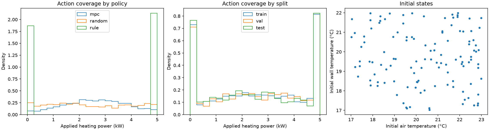
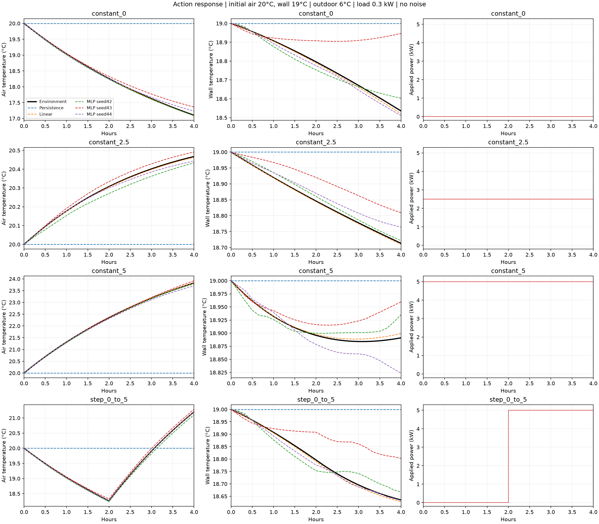
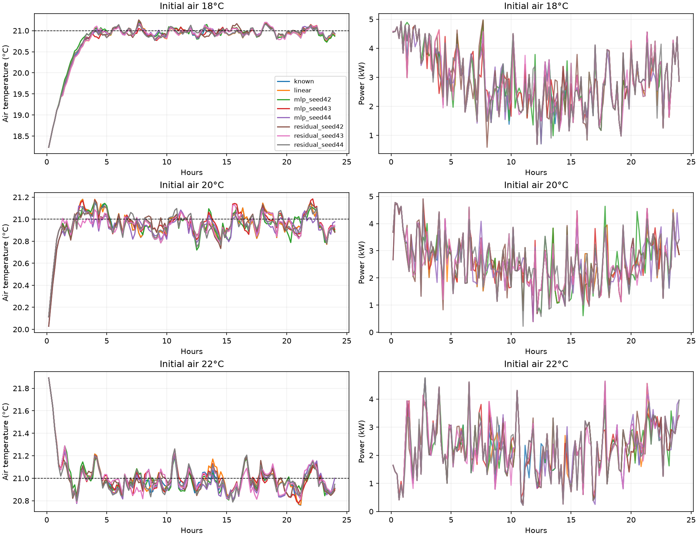
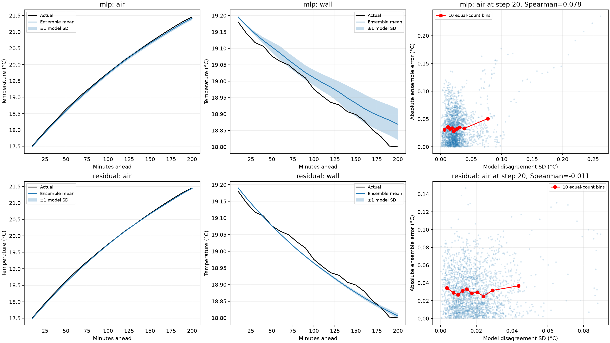
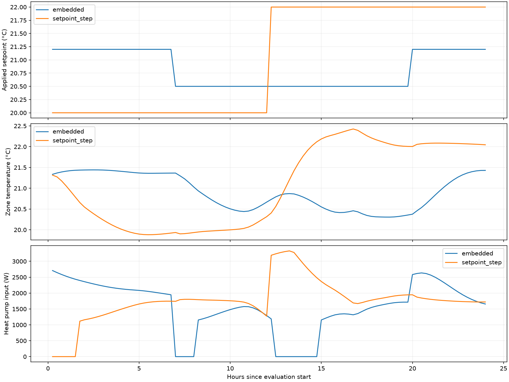

# Week 4 动作条件世界模型与自由 Rollout

## 任务和数据

本周在二阶热工模拟器训练动作条件动力学模型。状态为 [室温,墙温]，单位 °C，动作为实际加热功率，范围 0–5 kW，扰动为 [室外温度,内部负荷]，单位分别为 °C 和 kW。每步 10 分钟，每回合 144 步。完整字段与时序见 [动力学数据规范](../../docs/dynamics_schema.md)。

数据由分段随机功率、滞回规则、随机 shooting MPC 各采集 40 回合。初始室温在 17–23 °C、墙温在 17–22 °C 内采样。随机动作每 6 步重新采样。环境种子从 4000 开始，策略随机源与环境分开。完整配置见 [采集配置](../../configs/experiments/week4_thermal.yaml)。

| 切分 | 回合 | 转移 | 各策略回合数 |
|---|---:|---:|---:|
| train | 84 | 12096 | 各 28 |
| val | 18 | 2592 | 各 6 |
| test | 18 | 2592 | 各 6 |

使用种子 2026 按策略分层分配完整 episode。回合和场景 ID 的交集已检查，切分清单、完整环境参数及原始数据 SHA-256 见 [manifest.json](../../data/processed/week4_thermal/manifest.json)。场景由配置和初态定义，本实验检验同一物理参数与天气分布内的泛化。



## 模型和训练

统一接口为 `predict_next(state, action, exogenous)`，单样本与批量返回状态形状一致。Persistence 保持状态，线性模型拟合仿射下一状态，MLP 为两层 ReLU 网络并直接预测下一状态。Week 1 历史预测 API 继续单独使用。

训练输入采用真实当前状态、实际动作、当时带噪室外温度观测和已知内部负荷。输入输出分别使用训练集均值和总体标准差标准化。优化器 Adam，学习率 0.001，batch size 256，最多 300 epoch，验证误差连续 30 epoch 无改善则早停。固定种子 42 在隐藏宽度 64、128 间选参，随后对所选宽度训练种子 43、44。CUDA 使用确定性算法及 CUBLAS_WORKSPACE_CONFIG=:4096:8。

| 宽度 | 种子 | 最佳 epoch | 验证 MSE（°C²） |
|---|---:|---:|---:|
| 64 | 42 | 174 | 0.0001172421 |
| 128 | 42 | 114 | 0.0001312723 |
| 64 | 43 | 177 | 0.0001245670 |
| 64 | 44 | 201 | 0.0001181447 |

验证集选择宽度 64。检查点包含网络权重、结构、标准化参数和拟合状态，加载后可在 CPU 推理。软件版本和训练配置见 [config.json](results/training/config.json)，逐 epoch 日志与检查点位于同目录。

## 单步与自由递推

测试集 18 个回合各有 125 个可支持完整 20 步的起点，共 2250 个。全部模型与 horizon 使用相同起点。teacher-forced 每步读取真实当前状态，自由 rollout 只在起点读取真实状态，随后递推模型自身输出。每个步骤输入记录动作及该步室外温度观测、内部负荷。这是给定未来输入序列的离线动力学评测。

| 模型 | 1 步 | 5 步 | 10 步 | 20 步 |
|---|---:|---:|---:|---:|
| Persistence | 0.1513 | 0.5340 | 0.6176 | 0.8831 |
| Linear | 0.0098 | 0.0211 | 0.0285 | 0.0366 |
| MLP seed42 | 0.0103 | 0.0240 | 0.0337 | 0.0468 |
| MLP seed43 | 0.0120 | 0.0340 | 0.0486 | 0.0592 |
| MLP seed44 | 0.0113 | 0.0308 | 0.0446 | 0.0529 |

表中为自由 rollout 第 H 步室温 RMSE，单位 °C。每步 10 分钟，20 步对应 3 小时 20 分钟。完整 [metrics.csv](results/rollout/metrics.csv) 同时提供室温/墙温、MAE/RMSE、teacher/free、第 H 步和前 H 步平均两种定义。对应 NPZ 数组与 [起点清单](results/rollout/origins.csv) 可逐条追溯。窗口相互重叠，统计不确定性应按回合分组。

## 动作响应

固定初始室温 20 °C、墙温 19 °C、室外温度 6 °C、内部负荷 0.3 kW，关闭噪声。四组动作分别为 0、2.5、5 kW 恒定功率，以及 2 小时后从 0 切换到 5 kW。环境和所有模型分别推进 24 步。



各模型可响应动作变化，线性模型整体贴近环境。部分 MLP 的墙温曲线出现偏差。图中各面板纵轴范围不同，曲线视觉距离需要结合 °C 刻度判断。轨迹和配置见 [动作响应目录](results/action_response/)。

## 学习模型进入 MPC

预测时域 12，候选序列 256，动作范围 0–5 kW。每步重新规划，仅执行首动作。未来室外温度保持当前观测值，内部负荷按已知常量输入。环境含真实过程和测量噪声。三种初态 (18,19)、(20,20)、(22,21) 分别配对环境种子 42、43、44；五个模型配置共 45 回合。配对天气和噪声已逐项核对。小批量规划使用 CPU。

| MPC 内部模型 | 平均成本 | 跟踪 MAE（°C） | 能耗（kWh） | 平均决策耗时（ms） |
|---|---:|---:|---:|---:|
| 已知方程 | 79.179 | 0.1600 | 61.946 | 0.27 |
| Linear | 79.480 | 0.1612 | 61.965 | 0.57 |
| MLP seed42 | 78.488 | 0.1578 | 61.985 | 2.17 |
| MLP seed43 | 78.962 | 0.1582 | 62.053 | 2.16 |
| MLP seed44 | 79.438 | 0.1627 | 62.062 | 2.21 |

累计评测成本为各步温度跟踪偏差平方与能耗数值相加，权重均为 1。MPC 内部另有动作变化和舒适违规软惩罚。完整 [逐回合指标](results/closed_loop/episode_metrics.csv) 包含舒适违规、决策均值/P95、fallback；[分初态汇总](results/closed_loop/summary.csv) 为三个环境种子的均值和样本标准差。所有配置 fallback 为 0。



Linear 的离线预测误差最低。MLP seed42 在 9 个配对场景中 7 个成本更低，平均比已知方程改善约 0.87%，主要来自低初温场景。其他 MLP 种子收益较小或为负。以上比较使用同一测试集，seed42 的表现是测试后观察结果。后续正式选择检查点应采用独立验证场景，再在新测试场景报告收益。

## 复现与产出索引

在项目根目录激活 mvp 后运行：

```bash
bash scripts/reproduce_week4.sh
```

脚本依次采集、训练、预测评估、动作响应和闭环评估。将重建固定输出路径中的实验文件。单步命令为：

```bash
python scripts/collect_week4.py
python scripts/train_week4.py
python scripts/evaluate_week4.py
python scripts/plot_week4.py
python scripts/run_week4_control.py
```

采集数据在 data/processed/week4_thermal，结果在 reports/week4/results。运行脚本将记录当前 commit、工作区差异、软件版本和执行日志。撰写时仓库 HEAD 为 2006037ea9f92b6e5b1fc8af55a4073627614001，Week 4 代码仍有未提交文件，因此该 HEAD 单独不足以恢复本实验。完整复现需保留对应工作区或提交相关改动。

本报告覆盖 P0 的数据、动作条件模型、自由 rollout、动作响应和闭环对比。残差建模、物理约束、ensemble 校准及 IB/BOPTEST 迁移属于后续 P1。当前热工主实验使用完整真实状态，部分可观测环境需要另行处理历史或状态估计。

## P1 · 残差动力学对照

固定两层宽度 64，与直接模型使用同一数据切分、初始化种子、优化器、学习率及早停规则。残差模型预测 Δx，再将当前状态加回输出。目标标准化在训练集的 Δx 上拟合，因此目标尺度也随参数化改变；本对照评价这套残差训练方案的整体效果。

| 种子 | 残差最佳 epoch | 直接模型 20 步室温 RMSE °C | 残差模型 20 步室温 RMSE °C | 直接模型闭环成本 | 残差模型闭环成本 |
|---|---:|---:|---:|---:|---:|
| 42 | 47 | 0.046782 | 0.043812 | 78.488 | 79.548 |
| 43 | 35 | 0.059216 | 0.041855 | 78.962 | 79.466 |
| 44 | 48 | 0.052883 | 0.041589 | 79.438 | 78.968 |

残差模型在三个种子上均改善 20 步室温预测，闭环成本在种子 42、43 上升，44 下降。所有残差闭环回合完整结束，fallback 为 0。模型配置与检查点见 results/training_residual，完整预测表和闭环轨迹在原 rollout、closed_loop 结果目录中按 residual_seed 标识保存。

复现残差对照时，依次执行以下命令。评估脚本会同时加载已存在的直接模型与残差检查点。

```bash
python scripts/train_week4.py --residual
python scripts/evaluate_week4.py
python scripts/run_week4_control.py
```

## P1 · 物理启发变化速率约束

本次采用推理时输出投影，训练参数保持现有检查点。依据 ThermalConfig 的热导、热容量和步长，从当前状态推导一步温度增量区间。室外温度范围选为 [-5,17] °C，覆盖当前天气均值 6 °C、振幅 4 °C 的实验范围并留出余量；功率允许 0–5 kW，内部负荷为 0.3 kW。增量上下界再放宽 0.03 °C，作为过程噪声标准差 0.01 °C 的三倍启发式余量。高斯噪声支持无界，该余量仅用于实验约束。

对每个状态分量，先得到原始下一状态，计算其与当前状态之差，再截断至推导区间后加回当前状态。此区间依据当前状态与允许输入范围，适合作为输出变化速率检查。误差、触发率均按温度分量统计，和舒适区违反率分别报告。

测试使用 2250 个共同起点，20 步共 45000 个预测点/模型。每一步将修正后的状态继续递推，同时记录在同一输入状态下的原始与修正输出。直接 MLP seed43 的墙温触发 59 次，比例 0.1311%，修正前后 RMSE 为 0.056083、0.056042 °C，改善很小。其余直接 MLP 及三个残差 MLP 均未触发，输出保持一致。

因此本实验的速率约束对域内数据影响有限。大部分模型输出已经落在所设变化范围内，无法据此声称约束显著提高预测精度。此处 raw 是受约束 rollout 访问状态下的局部原始输出；独立无约束 rollout 结果仍见 rollout/metrics.csv。

逐点 actual、raw、projected、triggered 保存在 results/physics_constraints 的 NPZ，配套 origins.csv 给出 episode、起点和 horizon。metrics.csv、config.json 保存完整口径。脚本为 scripts/evaluate_week4_constraints.py，封装为 models/physics_constraints.py。构造每步跳升 100 °C 的异常模型已验证投影能实际触发并返回边界内增量。

## P1 · 训练时变化速率正则

在残差 MLP 上加入可微惩罚。设预测增量为 Δx_hat，上下界为 L、U，与前述投影使用相同热工参数、室外范围和噪声余量。损失为标准化目标 MSE 加 λ 倍的平均平方超界量，超界量按 0.03 °C 缩放。λ 本次预设为 1。此惩罚仅在越界时产生梯度，推理输出保留网络原值。

$$
\mathcal L=\mathcal L_{\mathrm{MSE}}+
\lambda\operatorname{mean}\left[
\left(\frac{\max(L-\widehat{\Delta x},0)+
\max(\widehat{\Delta x}-U,0)}{0.03\ ^\circ\mathrm C}\right)^2\right].
$$

同一数据、64 宽度和三个种子的实验已完成。三个最佳检查点与无正则残差模型权重逐元素完全相同，说明该配置下正则没有改变保存模型。测试集每模型 45000 个递推预测点的速率越界数均为 0。20 步室温 RMSE 依次为 0.043812、0.041855、0.041589 °C，与原残差基线一致。本实验没有观察到收益，也没有因测试结果收紧物理边界。

训练命令为 `python scripts/train_week4.py --residual --rate-weight 1`。配置、逐 epoch 总损失日志、检查点与权重比较保存在 results/training_rate_1。预测结果在 rollout，速率检查在 physics_constraints。本次没有重新运行正则模型闭环，保存网络权重相同，可对应原残差模型的推理结果。

## P1 · 三种子 Ensemble

分别将直接 MLP 和残差 MLP 的 42、43、44 检查点组成 ensemble。每个成员从相同真实起点独立自由递推，随后逐 horizon 计算三模型均值及样本标准差（ddof=1）。数据切分和未来动作/扰动信息沿用离线 rollout 协议。下表为 2250 个共同起点的第 20 步结果。

| 模型族 | 状态 | 均值预测 MAE °C | 均值预测 RMSE °C | 平均模型间 SD °C | 分歧与绝对误差 Spearman |
|---|---|---:|---:|---:|---:|
| 直接 MLP | 室温 | 0.034243 | 0.044992 | 0.027036 | 0.077647 |
| 直接 MLP | 墙温 | 0.046045 | 0.059437 | 0.034769 | 0.075287 |
| 残差 MLP | 室温 | 0.030526 | 0.038489 | 0.018247 | -0.011357 |
| 残差 MLP | 墙温 | 0.035450 | 0.043538 | 0.006455 | -0.042457 |



左两列采用起点清单中第一个固定窗口，对比真实轨迹、ensemble 均值和 ±1 模型间标准差。右列固定第 20 步室温，对照模型间 SD 与绝对误差；红线为按分歧排序后的十个等样本数分箱均值。窗口身份见 protocol.json。

残差 ensemble 的预测误差较低。但相关系数接近零，当前域内数据中，模型分歧对误差大小的排序能力很弱。阴影表示三模型的分歧，预测区间覆盖率尚未校准，过程噪声也未显式纳入该 SD。起点窗口重叠，相关系数作描述性统计，未进行独立样本显著性推断。

运行 `python scripts/evaluate_week4_ensemble.py` 可复现。results/ensemble 保存原始成员预测、均值、SD、真值、分 horizon 指标、分箱值和协议。

## P1 · IB 历史建模

采集 30 个独立 IB 回合，每回合 300 步，setpoint=50。环境种子 7000–7029，动作随机源 17000–17029，每 5 步重新采样一次 [-1,1] 三维增量命令。使用种子 2026 分配 21/4/5 个训练、验证、测试回合。同一 episode 的转移均保留在同一集合。此次采用随机动作策略，泛化范围为固定工况下的随机动作分布。

预测目标为下一步六维公开观测。两个模型均预测观测增量。MLP 使用当前六维观测和当前三维动作；GRU 使用 20 步序列，每步包含观测与该步向外执行的动作，因此历史 19 步动作与当前动作均可用。两者输出同一批测试时刻，隐藏诊断字段未进入训练输入。输入输出标准化参数仅在训练回合拟合。

MLP 使用两层 64 宽度 ReLU，GRU 使用单层 64 隐状态和线性输出。三种子均为 42、43、44，Adam 学习率 0.001，batch 256，最多 100 epoch，验证标准化 MSE 连续 12 epoch 无改善则早停。两者参数规模与归纳偏置不同，本实验比较完整的当前观测方案和历史方案。

| 公开观测目标 | 当前观测 MLP RMSE | 历史 GRU RMSE |
|---|---:|---:|
| setpoint | 0.0000 | 0.0000 |
| velocity | 0.0351 | 0.0348 |
| gain | 1.0306 | 1.0483 |
| shift | 0.8939 | 0.8062 |
| fatigue | 7.9924 | 7.8845 |
| consumption | 9.9546 | 4.6226 |

表为三个训练种子的测试 RMSE 均值，单位为对应 IB 基准尺度。每回合可用起点为 281，测试合计 1405 个共同预测目标。逐种子指标、最佳轮次、检查点、原始回合与测试预测见 results/ib_history。运行入口为 scripts/run_week4_ib_history.py。

GRU 的 consumption 误差下降约 53.6%，与该指标依赖历史动态的设定相符。fatigue 改善较小，gain 略差。当前 setpoint 恒定，零误差不代表能预测工况切换。公开观测和有限历史仍不能恢复全部隐状态与随机冲击，单步历史建模也不能直接证明长期自由 rollout 稳定。后续多步评测需在起点用真实历史初始化，之后仅滚入预测观测及给定动作，并明确工况信息边界。

### 补充对照 · 20 步历史 MLP

使用原始 episodes.npz，按与前次相同的分组 ID、标准化方法和训练规则训练 42、43、44 三个种子。测试起点清单已逐项核对。历史 MLP 将 20 × 9 输入展开为 180 维，使用两层 64 宽度 ReLU 和六维增量输出。最佳 epoch 为 48、42、46。

| 变量 | 当前 MLP | 20 步历史 MLP | 20 步 GRU |
|---|---:|---:|---:|
| velocity | 0.0351 | 0.0704 | 0.0348 |
| gain | 1.0306 | 1.5211 | 1.0483 |
| shift | 0.8939 | 1.1070 | 0.8062 |
| fatigue | 7.9924 | 8.2363 | 7.8845 |
| consumption | 9.9546 | 4.9230 | 4.6226 |

表为三个种子测试 RMSE 的均值，采用 IB 基准尺度。加入历史后 consumption 误差下降约 50.5%；同样历史下 GRU 相对历史 MLP 再下降约 6.1%。这支持历史信息在 consumption 预测中的作用。当前观测 MLP 在 velocity/gain 等直接操纵量上更准；历史展开增加输入维度，在固定数据量和训练配置下可能增加拟合难度。

两个历史模型输入一致，但参数量与结构仍不同，该比较是固定配置下的方案比较。尚未比较不同历史长度或匹配参数量。检查点、预测和日志按 history_mlp 前缀保存在 results/ib_history；脚本为 scripts/run_week4_ib_history_mlp.py。

## P1 · BOPTEST 可写动作迁移

本地 v0.9.0 的 inputs API 已核对。oveTSet_u 为绝对室温设定值，单位 K，允许 278.15–308.15 K（5–35 °C），配套 oveTSet_activate 大于零时启用覆盖。另有 oveHeaPumY_u（压缩机调节 0–1）、oveFan_u、ovePum_u（开关 0/1）及各自 activate，本实验只覆盖室温设定值。

使用原案例、一天预热、同一评测日和 900 秒控制步，分别运行内置控制与 20 °C→22 °C 阶跃，每个回合 96 步。阶跃发生在评测第 12 小时。每步发送覆盖指令，通过 results API 回读实际生效的 oveTSet_u，已逐步验证覆盖期请求与生效值一致。其余执行器沿用内置控制。advance 的测点未提供 oveTSet_y，因此实际输入来自服务端 results 的输入历史。



| 回合 | ener_tot kWh/m² | tdis_tot K·h/zone | pele_tot kW/m² |
|---|---:|---:|---:|
| 内置控制 | 0.255518 | 0.543947 | 0.017055 |
| 20→22 °C 设定值阶跃 | 0.283263 | 5.221054 | 0.020090 |

阶跃方案能耗和官方舒适偏差均增加。官方舒适上下限由案例日程定义，控制器覆盖设定值后该日程仍决定 KPI。此次验证控制通道、实际输入及楼宇响应，未执行策略优化。

脚本为 scripts/run_week4_boptest_actions.py。results/boptest_actions 保存 inputs/measurements 原始元数据、192 条逐步轨迹、两回合 KPI、配置与响应图。此实验通过原生 API 执行控制覆盖，现有 BoptestEnv.step 的默认模式仍为内置控制。
