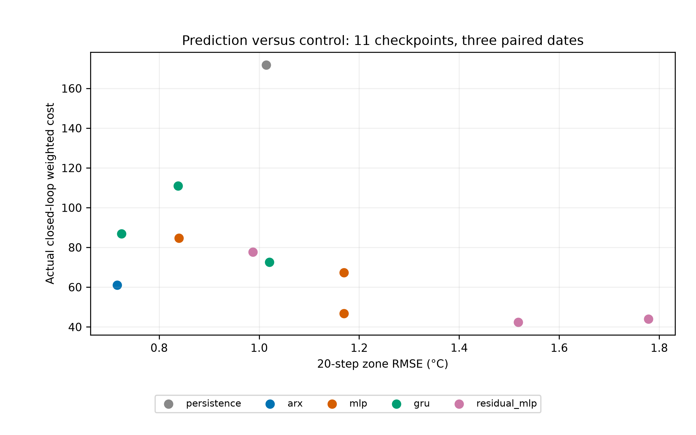

# 任务7：预测—控制一致性验收

全部11模型在共同8日期上配对。主散点取三个参考日期均值；横轴为固定动作、天气保持条件下20步（5小时）区域温度RMSE，纵轴为真实BOPTEST闭环累计成本。MPC时域为12步（3小时）并每15分钟纠偏，预测/控制的动作分布及目标均不同，散点表达关联。

## 案例1 · id_test_day340

persistence 温度RMSE 0.667°C，小于 residual_mlp_seed43 的 1.880°C；闭环成本为 382.97 与 108.40。
实际能耗 87.78/100.51 kWh，舒适累计偏差 100.80/8.44 °C·h，fallback 0/0 次。
Persistence缺乏动作响应，离线温度变化慢时可以获得较小误差，规划仍可能选择不利设定值。
轨迹A：`reports/week6/results/closed_loop/id_test_day340__persistence__clean.csv`；轨迹B：`reports/week6/results/closed_loop/id_test_day340__residual_mlp_seed43__clean.csv`。

## 案例2 · ood_cold_day024

gru_seed43 温度RMSE 0.874°C，小于 residual_mlp_seed44 的 1.063°C；闭环成本为 295.36 与 102.04。
实际能耗 57.99/88.55 kWh，舒适累计偏差 97.39/18.21 °C·h，fallback 0/0 次。
两个模型的实际能耗与舒适偏差体现不同的动作权衡。单一温度RMSE没有评价能耗头、候选动作响应或反馈纠偏，不能从排序反转唯一归因于网络结构。
轨迹A：`reports/week6/results/closed_loop/ood_cold_day024__gru_seed43__clean.csv`；轨迹B：`reports/week6/results/closed_loop/ood_cold_day024__residual_mlp_seed44__clean.csv`。

fallback曲线属于模型MPC与内置后备的混合系统。原始状态与动作、舒适界限和成本均保留于逐步CSV；无效开环预测应连同有效比例查看。