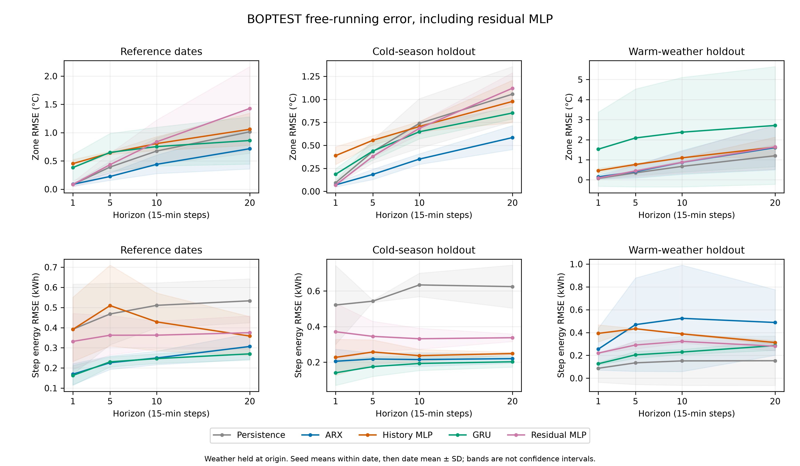
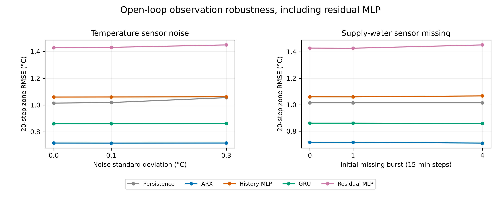
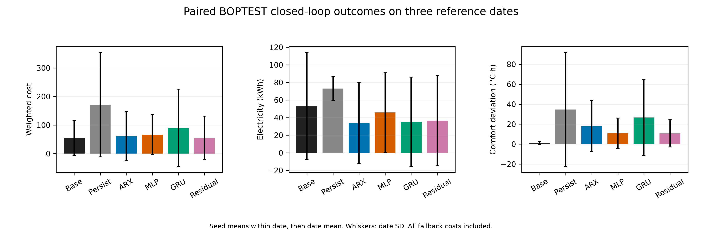
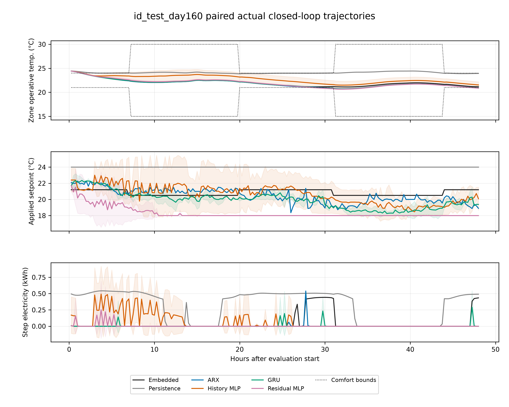
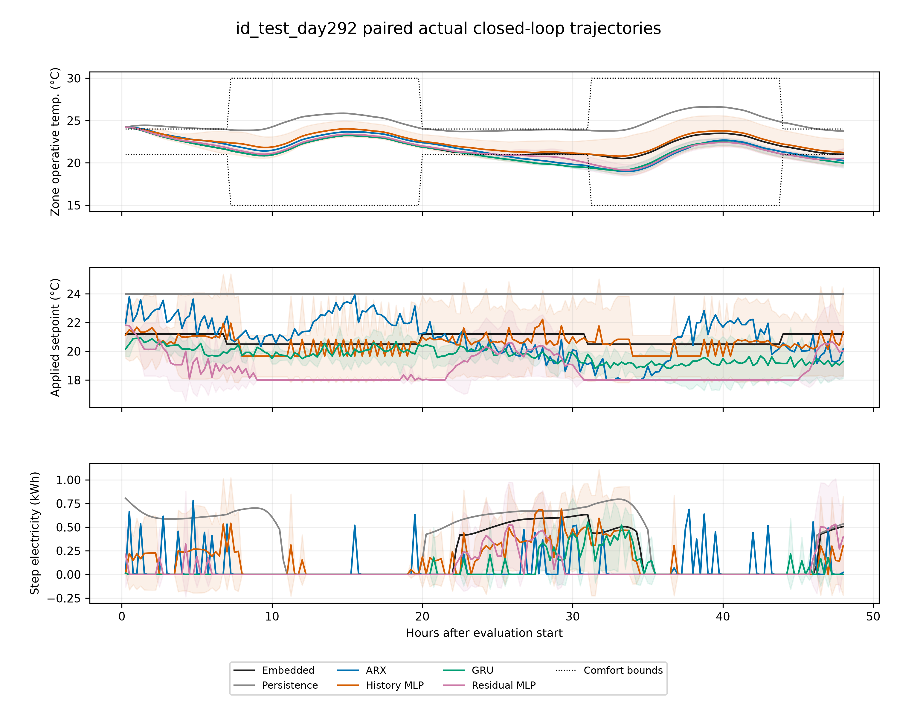
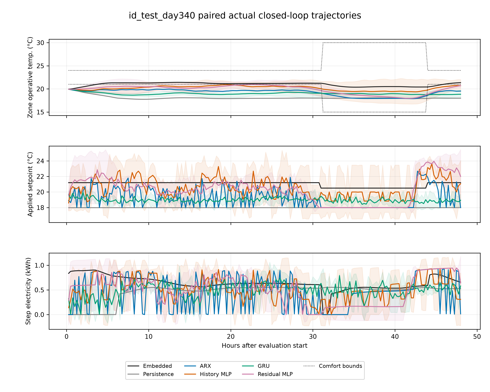
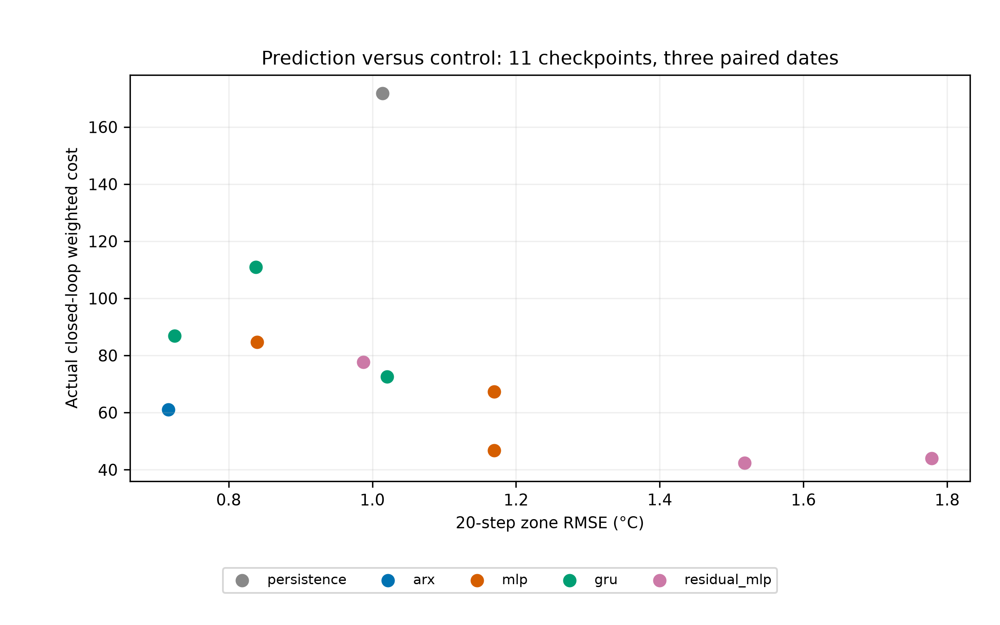
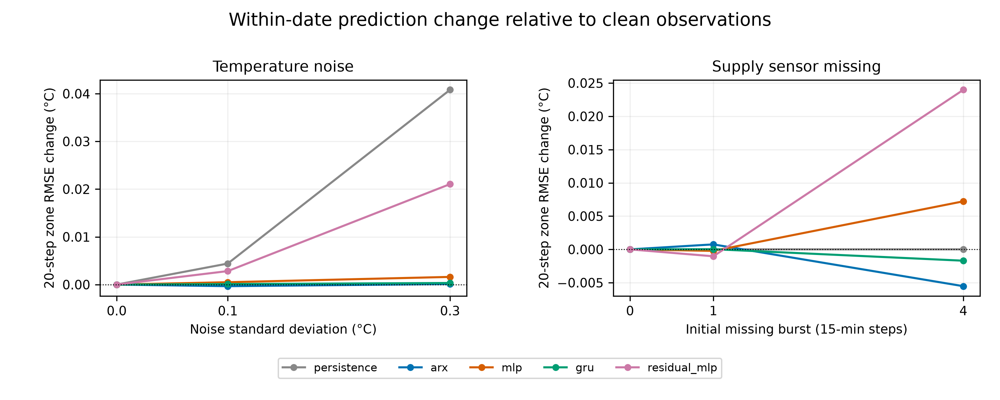
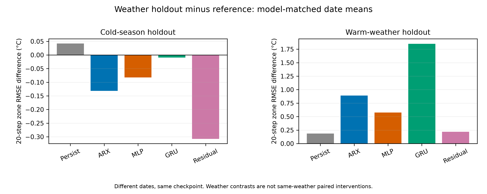

# Week 6 · BOPTEST完整评测与验收

本报告覆盖Persistence、ARX、三种子历史MLP、GRU、历史残差MLP，共11个检查点，另含embedded内置控制工程基线。18个采集时间块、5184条转移，训练8块/验证2块，测试8个日期。完成96个clean、72个噪声/缺失、36个目标变化闭环，共204回合、39168个有效评分步。

## 复现入口

```bash
conda activate mvp
python scripts/evaluate_week6.py --config configs/experiments/week6_pipeline.yaml --stage verify
python scripts/evaluate_week6.py --config configs/experiments/week6_pipeline.yaml --stage report
bash scripts/reproduce_week6.sh
```

verify检查已有结果；report重建比较表/图/报告并验收；reproduce完整运行采集、训练、开环、闭环及验收。完整运行需要本地BOPTEST v0.9.0服务、冻结FMU和依赖已安装。训练/控制允许验证已有完整文件后续跑。原始配置固定于week6_evaluation.yaml，残差扩展于week6_residual_evaluation.yaml，由week6_pipeline.yaml统一编排。此入口支持这组已冻结协议，修改实验协议需要显式形成新版本。

每次执行产生独立reproduction目录、逐步日志和status.json。异常以failed状态保留并终止后续步骤；已有partial、failure、fallback和无效预测文件保留。源轨迹的非物理预测不在评测中自动修正。配置与数据/权重哈希由协议检查校验。

## 模型、信息集与公平性

输入16步×12特征，包含5个公开观测、实际/候选设定值、两项天气、四项日历。输出下一5个观测及本步电耗。MLP与残差MLP均为192→128ReLU→64ReLU→6，残差模型前5个输出为增量，第6个能耗直接预测；GRU单层64隐藏单元。三个训练种子42/43/44，训练尺度仅用训练块拟合，验证早停。

同日期模型使用相同初始历史和真实天气，MPC候选256条、时域12步（3小时）、15分钟重规划、动作18～24°C，固定同一候选流，预算5秒。舒适上下界独立于动作。成本为区外温差平方×0.25小时+本步电耗+0.02×动作变化平方。能耗来自热泵/风机/水泵原生累计积分差，已独立核对。对所有候选无效、超时、异常释放到内置控制，实际fallback成本保留。embedded具有内部传感器信息，作为工程参照。

## OOD与观测故障

主要参考日期160、292、340温度在训练支持内；日期172保留为额外日历变化。冷季12/24属于季节保留，温度在训练范围内。暖季196/208范围外比例约5.73%/62.50%。目标OOD将同日独立舒适上下界+1°C。观测温度噪声和供水传感器缺失另行评测。未覆盖专门的负载干预与范围外初态初始化。

## 开环结果

共同352起点，teacher forcing与自由递推两模式，六种信息/故障条件，1/5/10/20步预测。第20步为5小时后的末端误差。未来天气保持起点为主条件，理想API天气为单独对照。自由递推只使用自身预测更新状态历史。





完整原模型/残差合并指标在results/residual_mlp/open_comparison.csv；原始预测分别在results/open_loop和results/residual_mlp/open_loop。有效比例与物理警告一起查看，数值有限不代表物理合理。

## 配对闭环









柱状图为日期内平均训练种子、再平均日期，误差线为日期间标准差。轨迹阴影为同日期三个训练种子的标准差。完整204回合比较在results/residual_mlp/control_comparison.csv，逐步原始轨迹在results/closed_loop。

## 预测—控制一致性

下表是三个主要参考日期均值，不能将不同日期的累计成本理解成相同负载的因果实验。

| 模型 | 20步末端温度RMSE / °C | 闭环成本 | 能耗 / kWh | 舒适偏差 / °C·h |
| --- | --- | --- | --- | --- |
| arx | 0.716 | 61.00 | 33.67 | 18.03 |
| gru_seed42 | 1.021 | 72.54 | 41.32 | 20.32 |
| gru_seed43 | 0.838 | 110.94 | 30.12 | 33.48 |
| gru_seed44 | 0.725 | 86.89 | 34.01 | 26.09 |
| mlp_seed42 | 1.170 | 67.27 | 58.06 | 2.25 |
| mlp_seed43 | 1.170 | 46.79 | 28.33 | 13.66 |
| mlp_seed44 | 0.840 | 84.67 | 51.17 | 16.82 |
| persistence | 1.014 | 171.74 | 72.94 | 34.65 |
| residual_mlp_seed42 | 0.987 | 77.69 | 30.05 | 25.05 |
| residual_mlp_seed43 | 1.779 | 43.94 | 40.97 | 3.33 |
| residual_mlp_seed44 | 1.518 | 42.43 | 38.46 | 3.84 |



温度5小时末端预测与3小时滚动控制的目标、动作分布和反馈不同，排序可能一致或反转。至少两个不同日期的完整案例见[案例分析](results/consistency/cases.md)，包括能耗、舒适偏差、fallback与原始CSV路径。全部反转和逐日期表也保存在同目录。固定动作计划排序扩展含11个模型与12条实际策略计划，见results/residual_mlp/policy_ranking，条件一致率必须同时报告有效计划数。

## 验收文件与局限

任务1为results/protocol/verification.json；任务2为results/distribution；任务3为results/residual_mlp/robustness/verification.json；任务4原模型和残差输出分别验收；任务5为results/mpc/interface_and_cost_verification.json；任务6为results/closed_loop_acceptance/verification.json；任务7为results/consistency/verification.json。

数据来自单个物理仿真案例；参考日期支持范围匹配不保证联合ID，独立日期少，训练种子不算新的物理episode。预测能耗可能为负，导致候选无效与fallback，不能宣称工程可部署。已知方程MPC参考未实现，embedded是原生控制器基线。限幅/释放和启发性检查不构成现场安全认证。方法完整定义见[协议](../../docs/week6_protocol.md)，原始残差训练说明见[补充报告](residual_mlp.md)。


## P1：OOD与扰动性能变化

同日期配对预测差值、目标/故障控制差值和天气模型匹配对比均位于 [差值分析说明](results/degradation/README.md)。差值为变化条件减参考条件，误差/成本正值表示变差。天气日期不同，只报告模型匹配的分布差值，不当作同天气干预。闭环已评估最高故障强度，严重程度曲线对应已有开环实验。






## P1：fallback压力测试

测试文件为tests/test_week6_control.py，4项测试覆盖确定性超时、全候选负能耗、预测异常和部分候选无效。前三种故障必须释放既有覆盖，部分无效仍保留合法候选继续规划。真实API另外执行6步，逐类先覆盖23°C再触发故障，服务端oveTSet_activate均确认关闭，读取实际设定值和步能耗。验收证据为[真实API记录](results/fallback_stress/real_api_verification.json)及同目录unit_tests.log。超时由可控时钟注入，不代表发生了真实计算阻塞；时间预算仍不能抢占单次阻塞调用。


## P1：策略排序一致性

11个模型作为评价器，在8日期各预测12条相同固定动作计划的5小时成本，共1056次计划评分。排序、有效比例与regret见[验收汇总](results/residual_mlp/policy_ranking/acceptance_summary.csv)，定义见[说明](results/residual_mlp/policy_ranking/acceptance_notes.md)。真实前缀成本、共同历史/天气和指标均已独立核对。条件一致率与regret必须连同有效计划和可选日期数报告；无候选日期不填0regret。


## P1：episode配对bootstrap

按完整日期块重采样配对差值，seed6042，2000次百分位bootstrap给出95%区间。模型级保留11检查点；家族级先平均同日期固定训练种子，再重采样日期，窗口和种子不当作新物理episode。结果与请求/有效样本数见[汇总说明](results/bootstrap/README.md)及同目录6张CI表。噪声/缺失/目标变化只有3个参考日期，冷/暖每类2个日期，区间是小样本描述。单日期仅点估计，缺失episode使该区间不可用；天气不同日期不冒称同天气干预配对。
