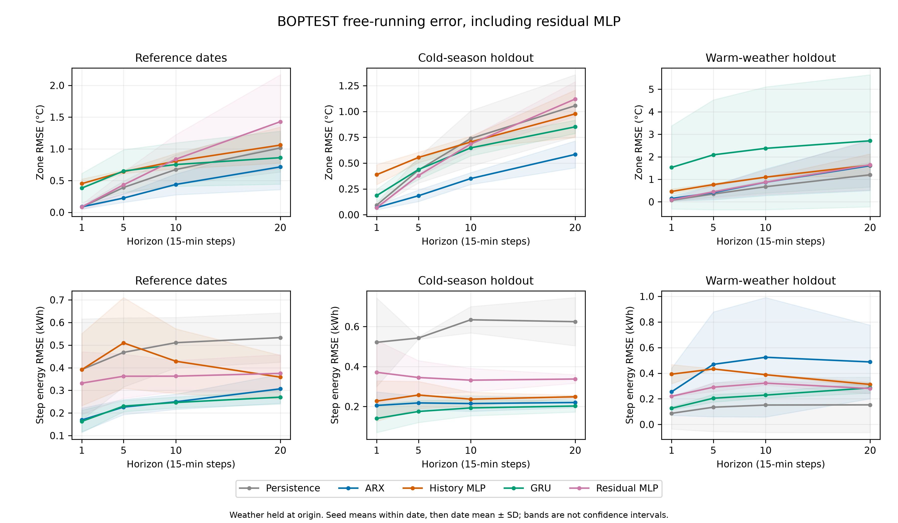
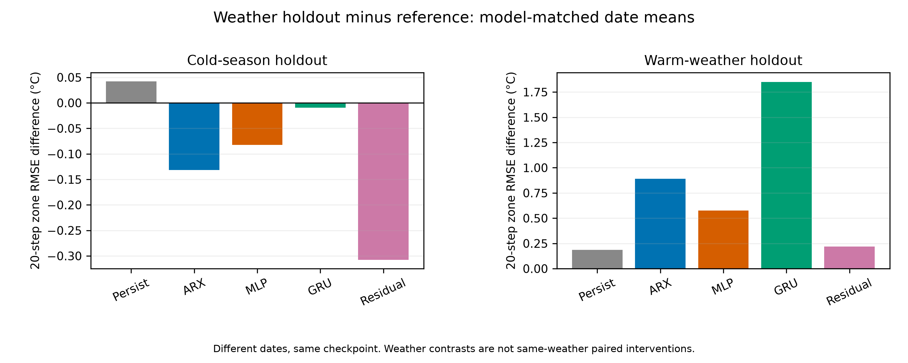
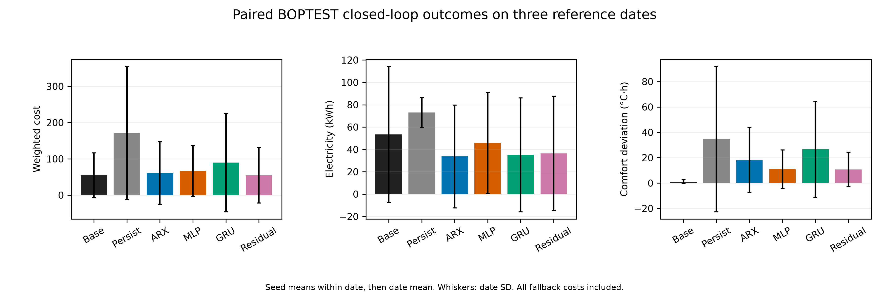

# 自动分析报告

本报告引用既有实验产物；具体实验条件与统计单位见 Week 6 协议。

## 误差—预测步长

SHA256：`6634d1aa9fa62805eaf9f19d400a69d1592d48e5dab48f3e0e6dd7a45df93d26`

## OOD 与观测故障

SHA256：`dbfc38b207348b9bc8c863809438819ac880bc29b1e9eb267bbaa832c325629a`

## 闭环控制成本

SHA256：`9f2fac921e0f395f8e333ac4333d2c8ccfa8b6c816bad8440cc268edb807b705`

## 闭环结果示例

| 模型 | 场景 | 条件 | 平均成本 | 回合数 |
| --- | --- | --- | ---: | ---: |
| arx | calendar_shift | clean | 11.968943183278407 | 1 |
| arx | ood_cold | clean | 102.65802581209815 | 2 |
| arx | ood_warm | clean | 135.66264564267155 | 2 |
| arx | reference | clean | 60.99766464774408 | 3 |
| arx | reference | goal_plus1 | 72.49521701081966 | 3 |
| arx | reference | missing_4 | 60.06834744002825 | 3 |
| arx | reference | noise_0p3 | 62.62575334124728 | 3 |
| embedded | calendar_shift | clean | 5.358386615933649 | 1 |
| embedded | ood_cold | clean | 86.22750890392089 | 2 |
| embedded | ood_warm | clean | 134.08255716002876 | 2 |
| embedded | reference | clean | 54.23661086137923 | 3 |
| embedded | reference | goal_plus1 | 68.94635567626702 | 3 |

来源：`reports/week6/results/summary/control_by_model.csv`；展示前 12 行，不作为全部结果排名。

## 可追溯预测—控制反例

| 时间块 | 较低 RMSE 模型 | 另一模型 | RMSE °C | 成本 | fallback 次数 |
| --- | --- | --- | --- | --- | --- |
| id_test_day340 | persistence | mlp_seed43 | 0.6666418176677932 / 0.7533830217311239 | 382.9707681888631 / 124.43689603218668 | 0 / 0 |
| id_test_day340 | persistence | mlp_seed42 | 0.6666418176677932 / 1.031299594331191 | 382.9707681888631 / 140.19121088871023 | 0 / 84 |

来源：`reports/week6/results/summary/prediction_control_counterexamples.csv`。较低开环误差与更高闭环成本同时出现；这是配对观察，不证明单一因果原因。

## 错误原因与限制

本报告只引用已保存证据。模型偏差、扰动或 fallback 是否解释某个案例，应查看对应逐步轨迹；不能仅凭图形推断因果。
实际模型/任务失败事件请查看对应 run 的 `events.jsonl` 和 `failure.json`。若文件不存在，不能推断没有失败。
