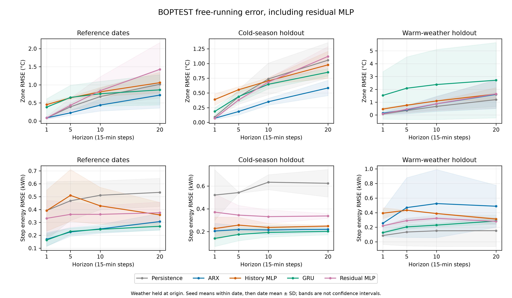
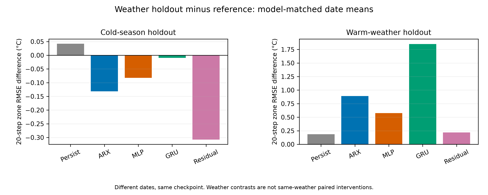
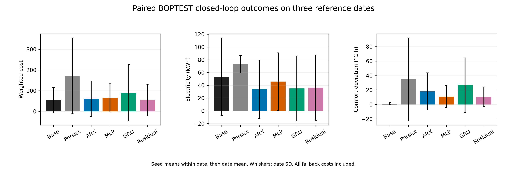

# 自动失败分析报告

本报告根据已有产物生成，不推断相关性的因果关系。
实验口径与统计单位见 [Week 6 报告](../week6/week6.md)。

## 误差—预测步长

来源：`reports/week6/results/residual_mlp/figures/open_loop_error_with_residual.png`；SHA256：`6634d1aa9fa62805eaf9f19d400a69d1592d48e5dab48f3e0e6dd7a45df93d26`。

## OOD 与观测故障

来源：`reports/week6/results/degradation/weather_minus_reference.png`；SHA256：`dbfc38b207348b9bc8c863809438819ac880bc29b1e9eb267bbaa832c325629a`。

## 闭环控制成本

来源：`reports/week6/results/residual_mlp/figures/closed_loop_kpis_with_residual.png`；SHA256：`9f2fac921e0f395f8e333ac4333d2c8ccfa8b6c816bad8440cc268edb807b705`。

## 闭环成本与 fallback 示例

| 模型 | 场景 | 条件 | 平均成本 | 回合数 | 平均 fallback 次数 |
| --- | --- | --- | ---: | ---: | ---: |
| arx | calendar_shift | clean | 11.968943183278407 | 1 | 21.0 |
| arx | ood_cold | clean | 102.65802581209815 | 2 | 0.0 |
| arx | ood_warm | clean | 135.66264564267155 | 2 | 70.5 |
| arx | reference | clean | 60.99766464774408 | 3 | 0.0 |
| arx | reference | goal_plus1 | 72.49521701081966 | 3 | 0.0 |
| arx | reference | missing_4 | 60.06834744002825 | 3 | 0.0 |
| arx | reference | noise_0p3 | 62.62575334124728 | 3 | 0.0 |
| embedded | calendar_shift | clean | 5.358386615933649 | 1 | 0.0 |
| embedded | ood_cold | clean | 86.22750890392089 | 2 | 0.0 |
| embedded | ood_warm | clean | 134.08255716002876 | 2 | 0.0 |
| embedded | reference | clean | 54.23661086137923 | 3 | 0.0 |
| embedded | reference | goal_plus1 | 68.94635567626702 | 3 | 0.0 |

仅展示前 12 行，不能作为完整排名。
来源：`reports/week6/results/summary/control_by_model.csv`；SHA256：`e7459235b2f856b0d3dc9de9ad1d54e10fd5651e3eb69090cd51aedddfb9632a`。

## 预测—控制不一致案例

| episode | 较低误差模型 | 对照模型 | RMSE A °C | RMSE B °C | 成本 A | 成本 B |
| --- | --- | --- | ---: | ---: | ---: | ---: |
| id_test_day340 | persistence | mlp_seed43 | 0.6666418176677932 | 0.7533830217311239 | 382.9707681888631 | 124.43689603218668 |
| id_test_day340 | persistence | mlp_seed42 | 0.6666418176677932 | 1.031299594331191 | 382.9707681888631 | 140.19121088871023 |

来源：`reports/week6/results/summary/prediction_control_counterexamples.csv`；SHA256：`ebf8776cbf2c79a4f1d658b05ba43b27faebb7c847efbcf33a4931cce04bd1f9`。

## 指定运行的失败记录

- [status.json](../runs/20261125T161838178918Z_boptest_smoke_6f18b6dd9065/status.json)：SHA256 `218ae41a454b57ff7b283eb1feab9cec424bd4a759309ec8cf1c2af8a5556cd5`。
  状态：`failed`。
- [failure.json](../runs/20261125T161838178918Z_boptest_smoke_6f18b6dd9065/failure.json)：SHA256 `af1969cbe791389dc41625a855e19c8ab4866cd050bfe0b10177eaa873834d92`。
  记录的异常类型：`RuntimeError`；消息：`BOPTEST POST /testcases/bestest_hydronic_heat_pump/select: timed out`。
  记录的执行阶段：`reset`。
- [events.jsonl](../runs/20261125T161838178918Z_boptest_smoke_6f18b6dd9065/events.jsonl)：SHA256 `c1fdac501f9584713c40c334656997fc657dd4201f779c1fddb5064084138ae7`。

模型偏差、天气或 fallback 的原因需要结合逐步轨迹检查；报告不自动赋予因果结论。
